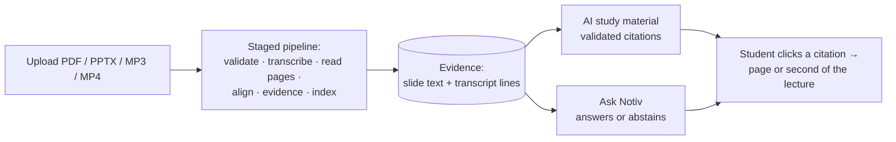

# Notiv

**There's always more to learn.** Notiv turns a lecture (PDF, PPTX, MP3 or MP4) into a place to study: an AI summary,
concepts, flashcards, a quiz, a mind map and a chat that answers only from the lecture. Every answer and every study item
links to the page or minute it came from.



## Documentation

| Doc | What it covers |
|---|---|
| [Product overview](docs/PRODUCT_OVERVIEW.md) | Problem, promises, users, features, screens, non-goals |
| [Architecture](docs/ARCHITECTURE.md) | System context, pipeline, page reading, LLM fallback, AI study, Ask, data model, security, deployment |
| [Evaluation](docs/EVALUATION.md) | Quality properties, evaluation layers, format matrix, AI scorecard and thresholds, live checks |
| [Results and testing](docs/RESULTS_AND_TESTING.md) | Current scores, test suite by area, regression history, **what is not verified** |
| [Deployment](docs/DEPLOYMENT.md) | Single-server and multi-server setups, environment, run, verify, troubleshoot |
| [Design system](docs/DESIGN_SYSTEM.md) | "Daybreak": tokens, type, brand, workspace shell, components, landing |
| [Sprints](docs/SPRINTS.md) | How Notiv was built, Sprint 1 to 14 |
| [Changelog](docs/CHANGELOG.md) | Changes per release |

**Project management** ([index](docs/project-management/README.md)): how the project was planned, run, tested and
closed.

| Doc | What it covers |
|---|---|
| [Project charter](docs/project-management/PROJECT_CHARTER.md) | Objectives, scope, success criteria, constraints |
| [PRD](docs/project-management/PRD.md) | Requirements with acceptance criteria and status |
| [Roadmap](docs/project-management/ROADMAP.md) | Phases delivered; now, next, later |
| [Milestones](docs/project-management/MILESTONES.md) | Dates, exit criteria and evidence |
| [Product backlog](docs/project-management/PRODUCT_BACKLOG.md) | Epics and open items, prioritised |
| [Risk register](docs/project-management/RISK_REGISTER.md) | Risks, scores, mitigations, status |
| [Decision log](docs/project-management/DECISION_LOG.md) | Key decisions and scope changes, with reasons |
| [QA test report](docs/project-management/QA_TEST_REPORT.md) | Test scope, results, defects, sign-off |
| [Go-live checklist](docs/project-management/GO_LIVE_CHECKLIST.md) | Release readiness for the Railway launch |
| [Project closure report](docs/project-management/PROJECT_CLOSURE_REPORT.md) | Outcomes vs goals, lessons learned, handover |
| [Case study](docs/project-management/CASE_STUDY.md) | One-page summary: problem, cuts, quality |

**Live demo:** https://notiv-production.up.railway.app (deployed 2026-11-22, **76 / 76** live checks).

Current state (2026-11-22):

* **pytest:** 636 passed, 2 skipped with PostgreSQL + S3 enabled (2026-11-17); latest default run 633 passed,
  6 skipped (2026-11-26, 639 tests).
* **Browser e2e:** 18 / 18, no console errors.
* **Format matrix:** 33 / 33.
* **Offline AI scorecard:** 100 % on all four metrics.
* **Deployment smoke test:** 41 / 41 in Docker (SQLite) and on PostgreSQL 16 + S3, with a live Groq answer model.
* **Live deployment (Railway):** 76 / 76 checks.
* **Not verified:** live AI quality at scale, password-reset email on the live demo, long real recordings. See
  [Results and testing §9](docs/RESULTS_AND_TESTING.md#9-not-verified--read-before-deploying).

## Quick start (development: SQLite + local files)

You need:

* Python 3.12 (3.11+ works).
* `ffmpeg` / `ffprobe` and `poppler-utils`.
* `libreoffice-impress` for PPTX.
* Optionally, `tesseract-ocr` for scanned pages.

```bash
python3 -m venv .venv && source .venv/bin/activate
pip install -r requirements-prod.txt -r requirements-test.txt
cp .env.example .env    # set NOTIV_AUTH_SECRET and NOTIV_SIGNING_SECRET: python -c 'import secrets; print(secrets.token_urlsafe(48))'
set -a; source .env; set +a
PYTHONPATH=.:core:backend uvicorn server.main:app --host 127.0.0.1 --port 8000
```

Open `http://127.0.0.1:8000` and create an account. Migrations run automatically on first connection. In development
the worker runs in-process (`NOTIV_INPROCESS_WORKER=1`); otherwise start `python -m core.lecture.worker`.

## Answer models

AI features work with any configured provider, tried in order. Without a provider, extractive summaries, flashcards and
quoted answers still work, and the UI names the reason AI material is missing.

```bash
NOTIV_LLM_PROVIDERS=openai,groq,mistral,anthropic        # order; providers without a key are skipped
NOTIV_VISION_PROVIDERS=openai,groq,anthropic             # re-reading handwritten / garbled pages
OPENAI_API_KEY=…  GROQ_API_KEY=…  MISTRAL_API_KEY=…  ANTHROPIC_API_KEY=…
```

Check the keys with `PYTHONPATH=.:core:backend python tools/llm_smoke.py`. Model and timeout variables are listed at the
top of `core/lecture/llm.py`.

## Configuration

Copy `.env.example`. Secrets may be supplied as `NOTIV_…_FILE`. With `NOTIV_ENV=production` the API and worker
**refuse to start** unless:

* `NOTIV_AUTH_SECRET` is strong.
* The database is PostgreSQL (`NOTIV_DATABASE_URL`) and storage is a private S3 bucket (`NOTIV_STORAGE=s3`,
  `NOTIV_S3_BUCKET`). A single-instance deployment may instead set `NOTIV_ALLOW_SQLITE_IN_PROD=1`,
  `NOTIV_ALLOW_LOCAL_STORAGE_IN_PROD=1` and `NOTIV_SINGLE_INSTANCE=1`.
* Rate limiting is shared (`NOTIV_RATELIMIT_BACKEND=db`) or explicitly single-instance.
* CORS has no `*` origin, and `/metrics` is protected by `NOTIV_METRICS_TOKEN`.

| Endpoint | Meaning |
|---|---|
| `/healthz` | liveness |
| `/readyz` | 503 until database, storage privacy, config, processing tools and answer model check out |
| `GET /upload-formats` | the accepted formats and limits |

Password reset needs an email sender and `NOTIV_PUBLIC_BASE_URL`: the Brevo API (`NOTIV_BREVO_API_KEY` +
`NOTIV_MAIL_FROM`, works on hosts that block SMTP) or SMTP (`NOTIV_SMTP_*`). Without one, reset requests fail clearly.

## Tests and evaluation

```bash
export PYTHONPATH=.:core:backend
python -m pytest -q core                                  # unit + integration
python tools/eval_format_matrix.py                        # 33 file variants through the real pipeline
python tools/eval_ai_study.py [--live]                    # AI scorecard; exits non-zero below threshold
pip install playwright && playwright install chromium    # once, for the browser e2e
python tools/e2e_redesign.py --out e2e-output             # browser end-to-end
python tools/e2e_media.py both                            # live MP3 / MP4 with word error rate
docker compose -f docker-compose.sprint5.yml up -d        # local PostgreSQL + private S3, then (env in the file header):
bash tools/verify_sprint5.sh                              # pytest incl. PostgreSQL / S3, plus the browser e2e
```

## Deploy

The Docker image is built and smoke-tested at 41 / 41 behind a simulated HTTPS proxy. You need about 2 GB RAM, a
volume at `/data` and one AI provider key. Full guide: [Deployment](docs/DEPLOYMENT.md).

```bash
docker build -t notiv .
docker run -d --name notiv --env-file prod.env -v notiv-data:/data -p 8000:8000 notiv   # host port: change the left 8000
python tools/smoke_deploy.py https://your-domain
```

## Layout

| Path | What |
|---|---|
| `core/lecture/` | Pipeline, extraction, evidence, retrieval, Ask, AI study, LLM layer, persistence, migrations |
| `backend/server/` | FastAPI app, routes and handlers, auth sessions, static UI |
| `core/test_*.py` | Tests |
| `tools/` | Evaluation and end-to-end scripts |
| `docs/` | Documentation |
| `Dockerfile`, `docker-entrypoint.sh` | Production image (runs as uid 10001, data on `/data`) |
| `docker-compose.sprint5.yml` | Local PostgreSQL + S3 for the integration tests only |
