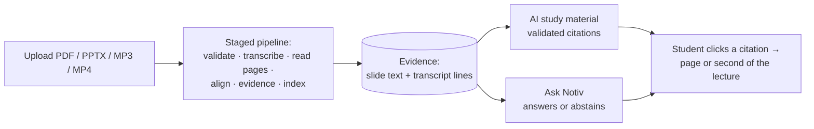

# Notiv

**There's always more to learn.** Notiv turns a lecture (PDF, PPTX, MP3 or MP4) into a place to study: an AI summary,
concepts, flashcards, a quiz, a mind map and a chat that answers only from the lecture. Every answer and every study item
links to the page or minute it came from.



## Documentation

| Doc | What it covers |
|---|---|
| [Product overview](docs/PRODUCT_OVERVIEW.md) | Problem, promises, users, features, screens, non-goals |
| [Architecture](docs/ARCHITECTURE.md) | System context, pipeline, page reading, LLM fallback, AI study, Ask, data model, security, deployment |
| [Evaluation](docs/EVALUATION.md) | Quality properties, evaluation layers, format matrix, AI scorecard and thresholds, live checks |
| [Results and testing](docs/RESULTS_AND_TESTING.md) | Current scores, test suite by area, regression history, **what is not verified** |
| [Sprints](docs/SPRINTS.md) | How Notiv was built, Sprint 1 to 13 |
| [Changelog](CHANGELOG.md) | Changes per release |

Current state (2026-10-31):

* **pytest:** 631 passed, 6 skipped.
* **Browser e2e:** 15 / 15.
* **Format matrix:** 33 / 33.
* **Offline AI scorecard:** 100 % on all four metrics.
* **Docker image:** built; deployment smoke test 41 / 41 behind a simulated HTTPS proxy.
* **Not verified:** live AI output (no working provider key), PostgreSQL and S3. See
  [Results and testing §9](docs/RESULTS_AND_TESTING.md#9-not-verified--read-before-deploying).

## Quick start (development: SQLite + local files)

You need:

* Python 3.12 (3.11+ works).
* `ffmpeg` / `ffprobe` and `poppler-utils`.
* `libreoffice-impress` for PPTX.
* Optionally, `tesseract-ocr` for scanned pages.

```bash
python3 -m venv .venv && source .venv/bin/activate
pip install -r requirements-prod.txt -r requirements-test.txt
cp .env.example .env    # set NOTIV_AUTH_SECRET: python -c 'import secrets; print(secrets.token_urlsafe(48))'
set -a; source .env; set +a
PYTHONPATH=.:core:backend uvicorn server.main:app --host 127.0.0.1 --port 8000
```

Open `http://127.0.0.1:8000` and create an account. Migrations run automatically on first connection. In development
the worker runs in-process (`NOTIV_INPROCESS_WORKER=1`); otherwise start `python -m core.lecture.worker`.

## Answer models

AI features work with any configured provider, tried in order. Without a provider, extractive summaries, flashcards and
quoted answers still work, and the UI names the reason AI material is missing.

```bash
NOTIV_LLM_PROVIDERS=openai,groq,mistral,anthropic        # order; providers without a key are skipped
NOTIV_VISION_PROVIDERS=openai,groq,anthropic             # re-reading handwritten / garbled pages
OPENAI_API_KEY=…  GROQ_API_KEY=…  MISTRAL_API_KEY=…  ANTHROPIC_API_KEY=…
```

Check the keys with `PYTHONPATH=.:core:backend python tools/llm_smoke.py`. Model and timeout variables are listed at the
top of `core/lecture/llm.py`.

## Configuration

Copy `.env.example`. Secrets may be supplied as `NOTIV_…_FILE`. With `NOTIV_ENV=production` the API and worker
**refuse to start** unless:

* `NOTIV_AUTH_SECRET` is strong.
* The database is PostgreSQL (`NOTIV_DATABASE_URL`) and storage is a private S3 bucket (`NOTIV_STORAGE=s3`,
  `NOTIV_S3_BUCKET`). A single-instance deployment may instead set `NOTIV_ALLOW_SQLITE_IN_PROD=1`,
  `NOTIV_ALLOW_LOCAL_STORAGE_IN_PROD=1` and `NOTIV_SINGLE_INSTANCE=1`.
* Rate limiting is shared (`NOTIV_RATELIMIT_BACKEND=db`) or explicitly single-instance.
* CORS has no `*` origin, and `/metrics` is protected by `NOTIV_METRICS_TOKEN`.

| Endpoint | Meaning |
|---|---|
| `/healthz` | liveness |
| `/readyz` | 503 until database, storage privacy, config, processing tools and answer model check out |
| `GET /upload-formats` | the accepted formats and limits |

Password reset needs SMTP (`NOTIV_SMTP_*`, `NOTIV_PUBLIC_BASE_URL`). Without it, reset requests fail clearly.

## Tests and evaluation

```bash
export PYTHONPATH=.:core:backend
python -m pytest -q core                                  # unit + integration
python tools/eval_format_matrix.py                        # 33 file variants through the real pipeline
python tools/eval_ai_study.py [--live]                    # AI scorecard; exits non-zero below threshold
python tools/e2e_redesign.py --out e2e-output             # browser end-to-end (Playwright + Chromium)
python tools/e2e_media.py both                            # live MP3 / MP4 with word error rate
bash tools/verify_sprint5.sh                              # PostgreSQL / S3 / FastAPI (docker-compose.sprint5.yml)
```

## Deploy

The Docker image is built and smoke-tested (see [Results and testing §6b](docs/RESULTS_AND_TESTING.md#6b-docker-deployment-smoke-test)).
It needs about **2 GB RAM** (Whisper, LibreOffice) and a **persistent volume at `/data`**, which holds the database,
uploads and the Whisper model. It listens on `$PORT` (default 8000) and trusts the platform's HTTPS proxy headers.

**Single server** (Railway, Render, Fly, a VPS): SQLite plus local files on the volume, worker in-process.

```bash
NOTIV_ENV=production
NOTIV_AUTH_SECRET=…                 # python -c 'import secrets; print(secrets.token_urlsafe(48))'
NOTIV_SIGNING_SECRET=…              # a different value of the same kind
NOTIV_ALLOW_SQLITE_IN_PROD=1
NOTIV_ALLOW_LOCAL_STORAGE_IN_PROD=1
NOTIV_SINGLE_INSTANCE=1
NOTIV_RATELIMIT_BACKEND=memory
NOTIV_INPROCESS_WORKER=1
NOTIV_CORS_ORIGINS=https://your-domain
NOTIV_PUBLIC_BASE_URL=https://your-domain
GROQ_API_KEY=…                      # or OPENAI_API_KEY / MISTRAL_API_KEY / ANTHROPIC_API_KEY
```

```bash
docker build -t notiv .
docker run -d --env-file prod.env -v notiv-data:/data -p 8000:8000 notiv
python tools/smoke_deploy.py https://your-domain          # 41 checks: accounts, all four formats, Ask, isolation
```

**Several servers:** PostgreSQL (`NOTIV_DATABASE_URL`), S3 (`NOTIV_STORAGE=s3`), `NOTIV_RATELIMIT_BACKEND=db`,
`NOTIV_INPROCESS_WORKER=0`, and run `python -m core.lecture.worker` as separate containers.

## Layout

| Path | What |
|---|---|
| `core/lecture/` | Pipeline, extraction, evidence, retrieval, Ask, AI study, LLM layer, persistence, migrations |
| `backend/server/` | FastAPI app, routes and handlers, auth sessions, static UI |
| `core/test_*.py` | Tests |
| `tools/` | Evaluation and end-to-end scripts |
| `docs/` | Documentation |
