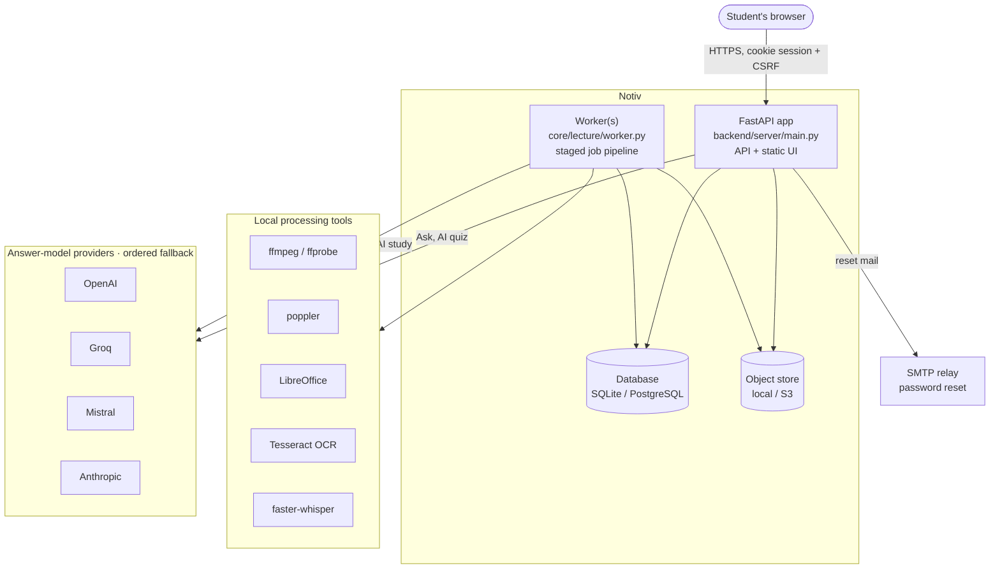
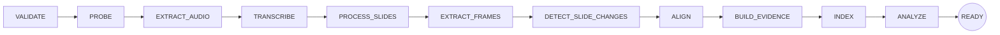
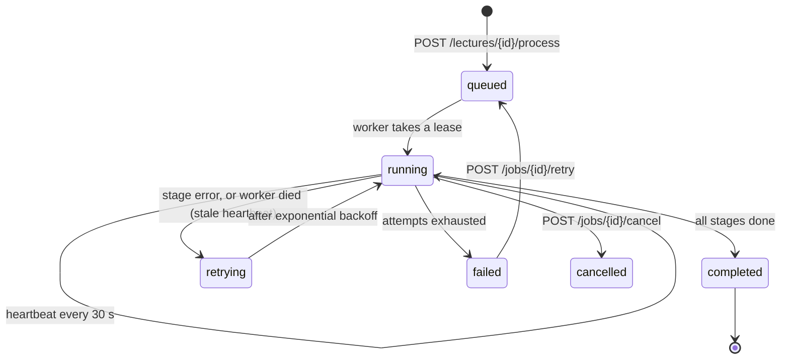
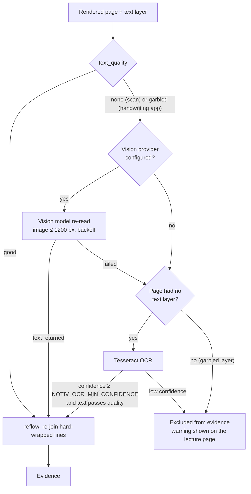
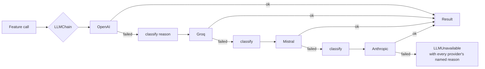
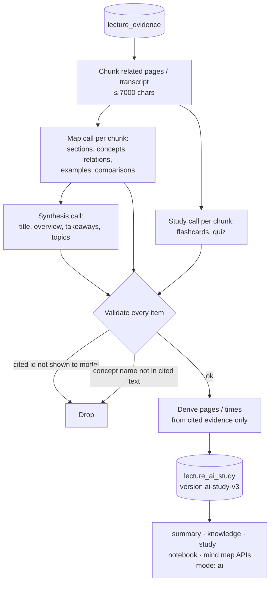
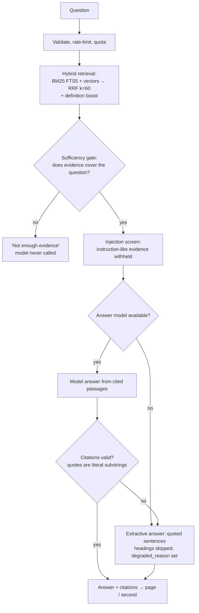
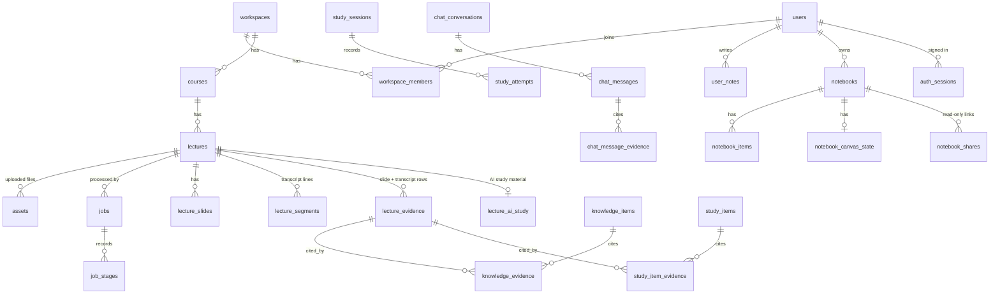
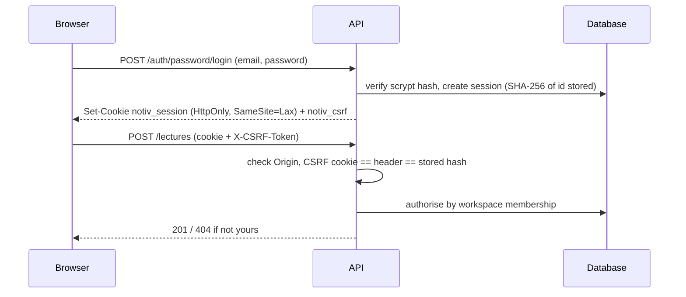
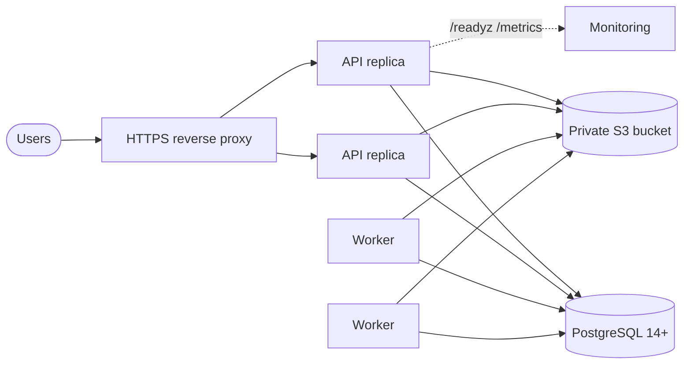

# Notiv — Architecture

Notiv is a single Python codebase with two processes: a **FastAPI web app** that serves the API and the static UI, and one
or more **workers** that process lectures through a durable, staged job pipeline. Both share one database (SQLite in
development, PostgreSQL in production) and one object store (local files or S3).

## 1. System context

## 2. Code layout

| Path | Responsibility |
|---|---|
| `backend/server/main.py` | FastAPI app, page routes, static files, middleware (`api/guards.py`: CSP, request id, size limits, rate limits) |
| `backend/server/api/routes_*.py` | HTTP routes: lectures, workspace, Ask, study, AI quiz, notes, notebooks, question bank, auth |
| `backend/server/api/*_handlers.py` | Framework-free handlers shared by FastAPI and the stdlib `dev_server.py` used in tests |
| `backend/server/auth_sessions.py` | Opaque server-side sessions, CSRF tokens, password reset tokens (stored hashed) |
| `backend/server/static/` | UI: `index.html` (landing), `auth.html`, desk, lecture, notebooks; ES modules under `ui/`; self-hosted fonts |
| `core/lecture/pipeline.py`, `jobs.py`, `worker.py` | Staged pipeline, durable jobs with leases and heartbeats, worker loop |
| `core/lecture/media.py`, `transcribe.py`, `slides.py`, `slide_match.py`, `align.py` | Extraction: probe, audio, transcription, slide rendering + text, frame matching, alignment |
| `core/lecture/evidence.py`, `passages.py`, `retrieval.py` | Evidence rows, passages, hybrid retrieval |
| `core/lecture/ask.py`, `qa.py` | Ask Notiv: sufficiency gate, injection screen, extractive or model answers, citation validation |
| `core/lecture/llm*.py` | One provider layer: chain, fallback, failure classification, adapters |
| `core/lecture/ai_study.py` | AI study material: chunked map calls, synthesis, validation |
| `core/lecture/knowledge.py`, `study.py`, `study_store.py`, `workspace.py` | Concepts, study items, sessions, summary, mind map |
| `core/lecture/store.py`, `repo.py`, `pg.py`, `migrations/` | Persistence, PostgreSQL translation, checksummed migrations 0001–0008 |
| `core/lecture/settings.py`, `health.py`, `obs.py`, `ratelimit.py`, `quotas.py` | Production config gate, `/readyz`, metrics, limits |
| `tools/` | Evaluation and end-to-end scripts (see [Evaluation](EVALUATION.md)) |

## 3. Lecture processing pipeline

A lecture is processed by one job. Each stage is idempotent, records its own result in `job_stages`, and reports
progress. Stages that do not apply (no recording → no transcription) finish immediately.

| Stage | What it does | Fails with a named reason when… |
|---|---|---|
| VALIDATE | checks type, signature, size; rejects encrypted / damaged PDFs and slide-less PPTX | the file is not one of the four formats or is broken |
| PROBE | ffprobe: duration, streams, separate `audio_duration`; ignores MP3 cover art | there is no audio track |
| EXTRACT_AUDIO | 16 kHz WAV; duration checked against the audio track (MP3 5 %, MP4 1 %) | the decode is truncated |
| TRANSCRIBE | faster-whisper `small`; segments checked for order, bounds, overlap, NaN | no speech is found or the transcript is invalid |
| PROCESS_SLIDES | renders pages; picks the best text source per page (see §4) | every page is unreadable |
| EXTRACT_FRAMES / DETECT_SLIDE_CHANGES | samples video frames; OpenCV matching with boundary bisection | (skipped without video + deck) |
| ALIGN | maps transcript lines to slides | |
| BUILD_EVIDENCE | writes `lecture_evidence` rows: slide text and transcript lines | |
| INDEX | FTS5 / BM25 index plus vectors | |
| ANALYZE | AI study material (§6), insights, knowledge and study items | never fails the lecture: without a provider, extractive output is kept and the reason is shown |

### Jobs and workers

Leases are fenced: a worker that lost its lease stops writing. Jobs are created once per lecture (idempotent), so a double
click on "Process" does not start two runs.

## 4. Reading a page: text-quality routing

Text layers are scored, not trusted. Handwriting apps often embed a "recognised" text layer of scattered single words;
storing that as evidence would poison every later step.

Vision is tried first because it reads handwriting; Tesseract only runs on pages with no text layer. Garbled-layer pages
are never sent to Tesseract: on handwriting it produces confident-looking junk.

## 5. Answer-model layer

Every AI feature (Ask, general-knowledge follow-ups, AI quiz, AI study material, page re-reading) goes through one
`LLMChain` in `core/lecture/llm.py`.

* Order: `NOTIV_LLM_PROVIDERS` (default `openai,groq,mistral,anthropic`); vision: `NOTIV_VISION_PROVIDERS`
  (default `openai,groq,anthropic`). Providers without a key are skipped. Lovable is opt-in.
* Each failure is classified (`llm.REASON_TEXT`): `rate_limited`, `timeout`, `unavailable`, `auth`, `quota_exhausted`,
  `daily_limit`, `unsupported_model`, `not_installed`, `refusal`, `truncated`, `empty`, …. Hard reasons (bad key, no credits, unsupported model, daily limit) put the
  provider on a 10-minute cool-down; transient ones respect `Retry-After` or 30 s.
* Batch work (AI study, vision) uses `call_with_backoff`: it waits out transient limits up to
  `NOTIV_AI_MAX_WAIT_SECONDS` and stops at once when every provider failed for a hard reason.
* `describe()` turns reasons into user-facing text ("OpenAI has no credits left") and HTTP codes (429 / 503 / 502 / 403).
* `NOTIV_*_MODEL` wins over the SDK-style `OPENAI_MODEL` / `OPENAI_BASE_URL`, so a stray variable cannot route OpenAI
  calls to another vendor's model name.

## 6. AI study material

* The model never chooses page numbers or timestamps: they are read from the evidence it cited.
* A concept keeps the lecture's own definition (`source_supported`) separate from any `supplementary_explanation`,
  which the UI labels.
* Without a provider, the extractive summary, knowledge and study items remain, and the UI shows why AI material is
  missing (`ai_unavailable`).

## 7. Ask Notiv

A separate, explicitly labelled **"Explain from general knowledge"** action exists for when the student wants an answer
beyond the lecture.

## 8. Data model (main tables)

Migrations (`core/lecture/migrations/{sqlite,postgres}/`), applied automatically and checksummed:

| # | Adds |
|---|---|
| 0001 | baseline: workspaces, courses, lectures, assets, jobs, slides, segments, timeline, evidence, insights, embeddings, chat, knowledge, study |
| 0002 | production: idempotency keys, rate limits, audit log, storage deletion outbox, worker heartbeats, job stages |
| 0003 | personal notes and their evidence links |
| 0004 | notebooks, sources, items, canvas, shares |
| 0005 | auth identities (kept; unused since OIDC removal, because applied migrations are checksummed) |
| 0006 | users, password auth, sessions, password resets |
| 0007 | manual question bank |
| 0008 | `lecture_ai_study` |

## 9. Security model

* Resources that are missing and resources that are not yours both return **404**, so ids cannot be probed.
* CSP `script-src 'self'`: no inline scripts; UI built with DOM APIs and `textContent`.
* Lecture text is treated as data: instruction-like passages are withheld from the model and from quotes.
* Share links store only a SHA-256 hash of the token; they expire and can be revoked.
* `NOTIV_ENV=production` refuses to start without a strong secret, PostgreSQL, private S3, shared or single-instance rate
  limiting, no `*` CORS and a metrics token (or explicit single-instance SQLite/local-storage overrides).

## 10. Deployment shape

* `/healthz` is liveness only. `/readyz` returns 503 until the database is at migration head, storage is reachable and
  private, config is valid, and it reports processing tools, Python packages and the answer model.
* Rate limiting: `NOTIV_RATELIMIT_BACKEND=db` for multiple replicas, or `NOTIV_SINGLE_INSTANCE=1`.
* Workers scale horizontally; leases keep two workers off the same job.
