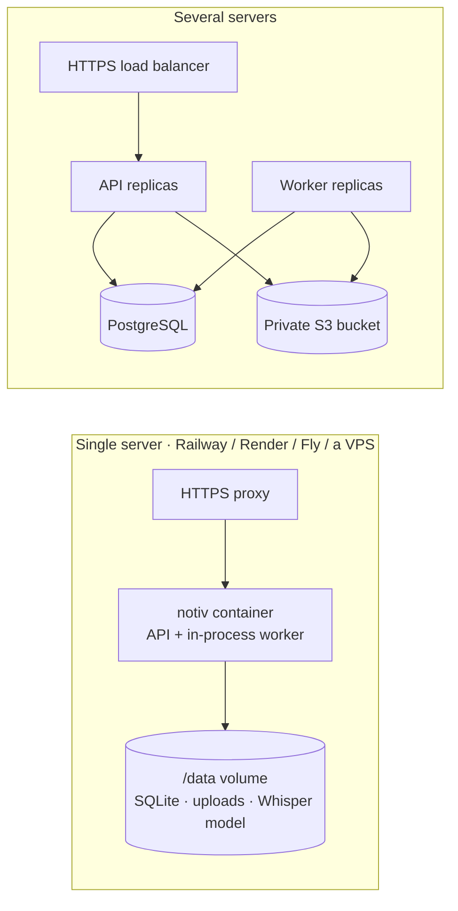

# Notiv — Deployment

How to run Notiv in production. The Docker image is verified: it was built and smoke-tested at 41 / 41, including behind a
simulated HTTPS proxy (see [Results and testing §6b](RESULTS_AND_TESTING.md#6b-docker-deployment-smoke-test)).

## 1. Shapes



| | Single server | Several servers |
|---|---|---|
| Database | SQLite on `/data` | PostgreSQL (`NOTIV_DATABASE_URL`) |
| Files | local storage on `/data` | private S3 (`NOTIV_STORAGE=s3`) |
| Worker | in-process (`NOTIV_INPROCESS_WORKER=1`) | `python -m core.lecture.worker` containers |
| Rate limits | `memory` + `NOTIV_SINGLE_INSTANCE=1` | `db` (shared) |
| Verified | ✅ Docker smoke test; ✅ live on Railway (76 / 76) | ✅ locally on PostgreSQL 16 + S3 (smoke 41 / 41); not run on a hosted platform |

## 2. Requirements

* At least **2 GB RAM**: Whisper transcription and LibreOffice run inside the container. 512 MB free tiers fail.
* A **persistent volume mounted at `/data`**. Without it, every redeploy deletes accounts and uploads.
* **HTTPS** in front of the container. The image trusts the platform proxy's `X-Forwarded-Proto` header
  (`FORWARDED_ALLOW_IPS=*`). Without that trust, every write fails the origin check.
* **One AI provider key** (OpenAI, Groq, Mistral or Anthropic) for AI summaries, quizzes and handwriting.
  Without one, the app still works with verbatim excerpts.

## 3. Environment (single server)

```bash
NOTIV_ENV=production
NOTIV_AUTH_SECRET=…                  # python -c 'import secrets; print(secrets.token_urlsafe(48))'
NOTIV_SIGNING_SECRET=…               # a different value of the same kind
NOTIV_ALLOW_SQLITE_IN_PROD=1
NOTIV_ALLOW_LOCAL_STORAGE_IN_PROD=1
NOTIV_SINGLE_INSTANCE=1
NOTIV_RATELIMIT_BACKEND=memory
NOTIV_INPROCESS_WORKER=1
NOTIV_CORS_ORIGINS=https://your-domain
NOTIV_PUBLIC_BASE_URL=https://your-domain
GROQ_API_KEY=…                       # or OPENAI_API_KEY / MISTRAL_API_KEY / ANTHROPIC_API_KEY
# optional: NOTIV_SMTP_HOST / _PORT / _USER / _PASSWORD / _FROM for password-reset email
```

The image already sets `NOTIV_LECTURE_DB=/data/lectures.db`, `NOTIV_STORAGE_DIR=/data/objects`, `HF_HOME=/data/hf` and
`PORT=8000`. It listens on `$PORT`, so platforms that inject their own port work unchanged.

With `NOTIV_ENV=production`, the app **refuses to start** if it finds any of these:

* a weak or missing secret;
* SQLite or local storage without the explicit overrides above;
* a `*` CORS origin;
* `/metrics` enabled without a token.

## 4. Run

```bash
docker build -t notiv .
docker run -d --env-file prod.env -v notiv-data:/data -p 8000:8000 notiv
```

The container starts as root only to make `/data` writable. It then drops to uid 10001; the app never runs as root.
Migrations run automatically on first connection.

**Several servers:**

```bash
docker run --env-file prod.env notiv python -m core.lecture.migrations upgrade
docker run --env-file prod.env -p 8000:8000 notiv                     # API, scale horizontally
docker run --env-file prod.env notiv python -m core.lecture.worker    # workers, scale horizontally
```

## 5. After deploying

```bash
curl https://your-domain/readyz                                      # every check "ok": true
python tools/smoke_deploy.py https://your-domain                     # 41 checks
PYTHONPATH=.:core:backend python tools/llm_smoke.py                  # the provider key answers
```

`/readyz` returns 503 until all of these check out: the database, storage privacy, config, the processing tools
(ffmpeg, poppler, LibreOffice, Tesseract) and the answer model. `smoke_deploy.py` creates two throwaway accounts. It then
uploads PDF, PPTX, MP3 and MP4 files and checks:

* processing;
* the transcript and summary;
* Ask with a citation;
* study items;
* that another account gets a 404.

## 6. Operations

| Need | How |
|---|---|
| Health | `/healthz` (liveness), `/readyz` (readiness, with reasons) |
| Metrics | `NOTIV_METRICS_ENABLED=1` + `NOTIV_METRICS_TOKEN`, then `GET /metrics` with the token |
| Logs | JSON lines on stdout (`NOTIV_LOG_FORMAT=json`), one per request with `request_id` |
| Backups | Snapshot the `/data` volume (SQLite + uploads); PostgreSQL / S3 use their own backups |
| Rotate the auth secret | Set the new `NOTIV_AUTH_SECRET`; put the old one in `NOTIV_AUTH_SECRET_PREVIOUS` until sessions expire |
| First upload slow | The first recording downloads the Whisper model (~2 min). It is then cached in `/data/hf` |

## 7. Troubleshooting

| Symptom | Cause | Fix |
|---|---|---|
| `readyz`: database / storage `PermissionError` | volume not writable | start the container as root (default) so the entrypoint can fix ownership |
| Every save says "origin check failed" | proxy headers not trusted | keep `FORWARDED_ALLOW_IPS`; set `NOTIV_PUBLIC_BASE_URL` to the https URL |
| Container restarts while processing | out of memory | at least 2 GB RAM |
| AI summaries missing, "no provider" | no working key | add a key; run `tools/llm_smoke.py` |
| "Forgot password" fails | SMTP not configured | set `NOTIV_SMTP_*` |
| Recordings fail with "No space left on device" | speech model cache filled the volume | clear `/data/hf`, use `NOTIV_WHISPER_MODEL=base`, or a larger volume |

## 8. Live deployment (Railway)

The public demo, `https://notiv-production.up.railway.app`, runs the single-server shape. It went live on 2026-11-22
and passed 76 / 76 live checks ([Results §6c](RESULTS_AND_TESTING.md#6c-live-deployment-railway)).

| Setting | Value |
|---|---|
| Source | this GitHub repository, built from the `Dockerfile` |
| Volume | Railway volume mounted at `/data` (the Dockerfile has no `VOLUME` line; Railway rejects it) |
| Port | `PORT=8080`, and the public domain targets port 8080 |
| Variables | the §3 list with the real domain, `GROQ_API_KEY`, and `NOTIV_WHISPER_MODEL=base` |
| Not configured | SMTP (password-reset email), metrics |

Why Railway: Notiv needs ffmpeg, LibreOffice and a speech model inside the container, about 2 GB RAM and a disk that
survives redeploys. Railway runs the Docker image unchanged with a persistent volume. Serverless platforms cannot run
these tools, and free tiers with 512 MB RAM fail during transcription.

