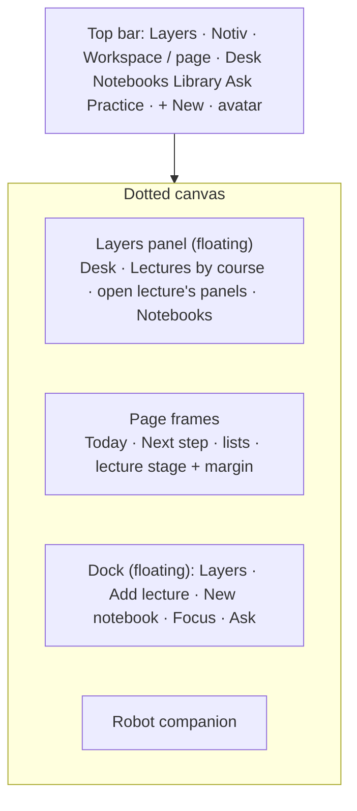

# Notiv — Design system ("Daybreak")

One product, two moods:

* **The landing page** is a dreamy sky told in an editorial serif.
* **The workspace** is the same light turned into a calm canvas.

Everything is plain CSS on tokens in `backend/server/static/ui/base.css`. There is no framework, no build step, and no
external font or CDN request.

## 1. Principles

* **The lecture is the source.** Every reference back to it, such as a citation, timestamp or slide number, is gold: the
  "golden thread".
* **One primary action per view.** Primary buttons are ink. Selection and links are periwinkle. Nothing else competes.
* **Canvas, not chrome.** No permanent sidebar. Navigation lives in a slim top bar; tools float above a dotted ground
  and get out of the way.
* **Light and quiet.** No dark mode, glass or blur. Gradients appear only in the landing story, the "next step" frame and
  the closing band. Motion respects `prefers-reduced-motion`.

## 2. Tokens

| Role | Token | Value |
|---|---|---|
| Canvas ground | `--ivory` | `#f7f5f0`, with `--dot` dots every 22 px |
| Frames, panels | `--paper` | `#ffffff` |
| Ink | `--ink` / `--ink-2` / `--ink-3` | `#1c1d2e` / `#4b4d66` / `#73758e` |
| Hairlines | `--rule` / `--rule-strong` | `#ebe9f1` / `#d7d5e1` |
| Selection, links, focus | `--clay` (periwinkle) | `#4f62d1`, tint `#eceffd` |
| Primary action | `--cta` | `#1c1d2e` |
| References (golden thread) | `--pencil` / `--gold` | `#9c7020` / `#d6a84f`, tint `#f8efd9` |
| Atmosphere | `--lavender`, `--lav-tint`, `--night` | `#a9a2e4`, `#f2f0fd`, `#1b2246` |
| States | `--olive`, `--amber`, `--danger` (+ `-tint`, `-ink`) | ready, in progress, failed |

Depth comes in three levels: `--lift` for frames on the canvas, `--float` for floating panels and the dock, and
`--shadow-pop` for dialogs and menus.

## 3. Type

| Use | Face | Where |
|---|---|---|
| Display: titles, wordmark, row titles, FAQ | Instrument Serif (self-hosted), italic for accent words | `h1–h3`, `.wordmark`, `.row-title` |
| Reading: answers, summaries, notes, quotes | EB Garamond (self-hosted) | `.msg .txt`, `.prose`, `.quote`, lede text |
| Interface | System UI (SF Pro on Apple devices) | everything else |
| Code / ids | SF Mono → Plex Mono | `.mono` |

On the landing page, accent words like "*more*" use a gold-to-lavender gradient, applied with `background-clip:text`.

## 4. Brand

* **Wordmark:** the text "Notiv" in Instrument Serif. There is no logo mark in the product UI.
* **Favicon:** a lavender-to-periwinkle tile with a white "N" and a gold dot (`favicon.svg`).
* **Companion:** a small friendly robot drawn in SVG (`companion.js`). It has:
  * a white head, a night-blue face and soft blue eyes that blink;
  * a gold antenna light that glows;
  * a gentle float animation.

  It opens Ask, the focus timer and practice, and it can be calmed or tucked away.

## 5. Workspace shell (`core.js → mountShell`)

* **Top bar:** the main sections appear as one segmented control, and the current page is marked. The **+ New** menu
  adds a lecture, notebook or course. The breadcrumb follows the page title.
* **Layers panel:**
  * Courses → lectures, each with a status dot, then notebooks. A filter box narrows the list.
  * The open lecture's panels (Transcript, Evidence, Summary…) appear as child layers and stay in step with its tabs.
  * Toggle it with the button, the dock or the **L** key.
  * It stays open by default at 1280 px and wider, and the page shifts right to make room. Narrower screens show it as
    an overlay. The choice is remembered.
* **Dock:** floating quick actions with tooltips.
* **Phones (≤ 760 px):**
  * The section tabs become a floating bottom bar with icons and labels.
  * The Layers panel becomes a full-width sheet, and the dock is hidden.
  * Dialogs open as bottom sheets.

## 6. Components

| Component | Classes | Notes |
|---|---|---|
| Frame label | `.eyebrow` | Periwinkle chip with a `#`, like a frame name on a canvas |
| Frame list | `.ledger` > `.row-link` | White frame, hairlines inset 14 px, chevron, lavender hover |
| Segmented control | `.tabs` / `.tab`, `.seg` | Sunk track, white selected segment |
| Buttons | `.btn`, `.primary`, `.quiet`, `.danger`, `.sm`, `.lg` | Outlined white by default, ink for primary |
| Status | `.chip.done / .running / .failed` | Olive / amber / danger |
| Reference | `.cite`, `.cc`, `.line .t`, `.quote` | Gold, clickable to the page or second |
| Notice | `.notice.warn / .err / .ok` | Tinted for warn and err |
| Dialog | `dialog`, `.dlg-head / -body / -foot` | Centered card; bottom sheet on phones |

## 7. Landing (`index.html`, `landing.css`)

1. **Hero:** `notiv.jpg`, served byte-identical and never filtered, with layered light: a night scrim behind the copy,
   golden haze, and a fade into ivory. The navigation floats over the sky.
2. **Statement:** one large serif sentence.
3. **Vista:** a close crop of the same sky, with the Ask story and a chat that cites its sources.
4. **The workspace as a canvas:** a real screenshot in a window frame on a dotted, lavender-to-ivory panel.
5. **Features:** a phone screenshot beside an editorial numbered list.
6. **Use cases:** sky-tinted cards.
7. **How it works:** four steps on a gold-to-lavender line.
8. **FAQs and resources.**
9. **Closing:** a daybreak gradient band.

The browser end-to-end test captures the product screenshots (`app-preview.png`, `app-phone.png`), so they always show
the current UI.

## 8. Accessibility

* Every interactive element is reachable by keyboard and shows a 2 px periwinkle focus ring.
* Menus close on Escape.
* Body text keeps contrast of at least 4.5:1, including `--ink-3` on white.
* Touch targets in the phone tab bar are at least 46 px.
* Reduced-motion users get no float, glow or panel animations. Forced-colours mode keeps borders and selection visible.
