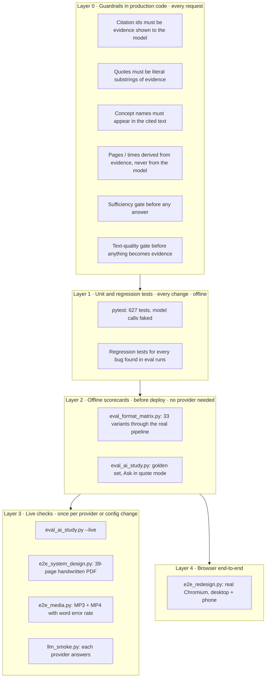
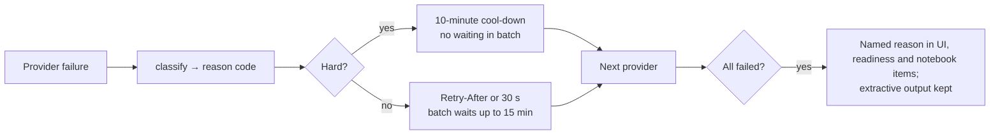

# Notiv — Evaluation

How Notiv's quality is measured. The goal is not "the demo worked once" but numbers that can be re-run and that can
gate a deploy. Measured results are in [Results and testing](RESULTS_AND_TESTING.md).

## 1. What "working" means

Notiv is a retrieval-and-generation system over a student's own material, so it is judged on five properties:

| Property | Question it answers | Main check |
|---|---|---|
| **Robustness** | Does every supported file end in the right outcome? | Format matrix |
| **Faithfulness** | Is every AI claim supported by the lecture? | Citation validation (hard rule) + support rate |
| **Retrieval quality** | Does Ask find the passage that answers the question? | Retrieval hit rate on a golden set |
| **Honesty** | Does Notiv refuse when the lecture cannot answer? | Abstention accuracy |
| **Transcription accuracy** | Are recordings heard correctly? | Word error rate against a known script |

## 2. Evaluation layers



Layer 0 is the most important: the checks run on every generated item in production, so an unfaithful citation is
dropped even if no evaluation ever looked at that lecture.

## 3. Format robustness matrix

`tools/eval_format_matrix.py` generates real files of every kind students upload and runs each through the real
validation and processing pipeline (ffmpeg, poppler, LibreOffice, faster-whisper). No AI provider is needed.

**Correct outcome:** a valid file is processed with usable evidence that contains expected keywords; an invalid file is
rejected at upload or fails with a clear, user-readable reason. A crash or a silent "done" with no content is wrong.

| Format | Valid variants (must process) | Invalid variants (must be rejected clearly) |
|---|---|---|
| PDF (11) | text deck, prose document, scanned image-only (OCR), rotated pages, mixed page sizes, Unicode text, 60 pages | password-protected, truncated, PNG renamed `.pdf`, empty file |
| PPTX (7) | title + bullets, table slide, hidden slide kept in order, grouped shapes, image-only slides (OCR), 30 slides | ZIP that is not a presentation |
| MP3 (7) | 128k CBR stereo, VBR, 8 kHz phone quality, with cover art, speech with background noise | silence only (must fail with "no speech"), WAV renamed `.mp3` |
| MP4 (8) | H.264 + AAC, H.264 + MP3, HEVC, vertical 9:16 at 60 fps, picture longer than sound, sound longer than picture | no audio track, MKV renamed `.mp4` |

```bash
PYTHONPATH=.:core:backend .venv/bin/python tools/eval_format_matrix.py [--quick] [--json out.json]
```

Speech is generated with macOS `say`, so transcripts can be checked against a script. Synthetic files are a proxy: the
score is a measurement on this matrix, not a guarantee for every file.

## 4. AI scorecard (golden set)

`tools/eval_ai_study.py` builds three small lectures (caching, distributed data, load balancing) with known facts,
known topics and questions that the lectures cannot answer, then measures:

| Metric | Definition | Threshold |
|---|---|---|
| `ask_retrieval_hit` | the evidence that answers the question is among what Ask cites | ≥ 90 % |
| `ask_answer_correct` | the answer contains the expected fact | ≥ 80 % |
| `ask_citation_valid` | every citation is real evidence of this lecture | 100 % |
| `ask_abstention` | unanswerable questions get "not enough evidence" | 100 % |
| `study_citation_valid` *(live)* | every section, concept, card and question cites real evidence | 100 % |
| `study_support_rate` *(live)* | share of summary and definition sentences whose content words appear in their cited evidence (≥ 0.6 overlap) | ≥ 80 % |
| `study_copy_rate_max` *(live)* | share of section summaries that are verbatim copies | ≤ 20 % |
| `study_topic_coverage` *(live)* | reference topics found in the generated material | ≥ 80 % |
| `study_quiz_valid` *(live)* | four distinct options, a valid answer index, a citation | 100 % |

```bash
PYTHONPATH=.:core:backend .venv/bin/python tools/eval_ai_study.py          # offline: retrieval + Ask in quote mode
set -a; source .env; set +a
PYTHONPATH=.:core:backend .venv/bin/python tools/eval_ai_study.py --live   # + model answers + AI study material
```

The script exits non-zero when any metric is below its threshold, so it can gate a deploy. Support rate is a **lexical
faithfulness proxy**, not a human judgement; it catches invented content but not subtle misreadings.

## 5. Live regression on a hard real document

`tools/e2e_system_design.py <pdf>` runs the user's own `systemdesgin.pdf`, which has 39 handwritten tablet pages whose
embedded text layer is garbled. It is the hardest real input seen so far and checks 34 things end to end:

* the garbled layer is detected and reported, and no junk becomes evidence;
* vision re-read covers every page, and required topics (indexes, queues, long polling, websockets…) are found;
* the summary is prose, not copied, and the overview is the right length;
* concepts are cited, with the source definition separate from the labelled supplementary explanation;
* flashcards and quiz questions are valid and cited;
* the mind map has nodes, edges and labelled relations;
* every notebook item type saves, and the canvas accepts the map;
* another user gets 404 on the summary and the notebook.

## 6. Recordings

`tools/e2e_media.py [mp3|mp4|both]` synthesises a lecture with a known script, uploads it through the API, and checks:

* processing time;
* segment count;
* **word error rate** against the script;
* timestamps ordered and inside the recording;
* every AI study item carries `times` that point at real transcript lines.

## 7. Provider failure evaluation

AI features fail in ordinary ways (no credits, bad key, daily limit). These are tested as behaviour, not as errors:



`core/test_llm.py` covers each classification and the chain order. `tools/llm_smoke.py` makes one real call per
configured provider and prints the named reason for any that fail.

## 8. Rules for honest reporting

1. A number is only reported after the command that produces it has run; the date and environment are recorded in the
   [Results and testing](RESULTS_AND_TESTING.md) log.
2. Skipped tests and unrun checks are written down as **UNVERIFIED**, never as passed.
3. Every bug found by an evaluation run gets a regression test before the run is repeated.
4. Faked model calls prove plumbing and grounding, not AI quality. That needs `--live`.
