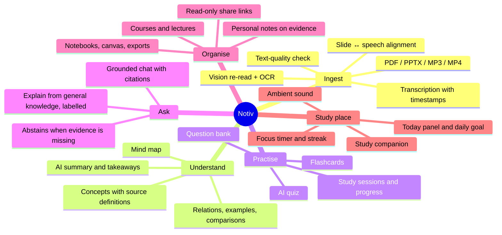
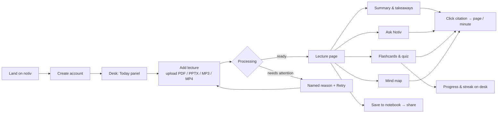

# Notiv — Product overview

> **There's always more to learn.** Notiv turns one lecture (slides, a document or a recording) into a place to study:
> a readable summary, concepts, flashcards, a quiz, a mind map and a chat that answers from the lecture. Every answer
> and every study item points to the page or minute it came from.

## The problem

Students get lectures as a pile of files: a slide deck, a scanned or handwritten PDF, an MP3 of the talk, a screen
recording. Generic AI tools summarise them, but the student cannot tell which part of the summary is from the lecture and
which part the model made up, and a wrong answer in an exam costs more than no answer.

## What Notiv promises

| Promise | How it is kept |
|---|---|
| **Grounded** | Study material and answers are built only from *evidence* rows (slide text, transcript lines). Every citation is checked against that evidence before it is saved or shown. |
| **Honest** | When the lecture does not answer a question, Notiv says "not enough evidence" instead of guessing. Unreadable pages, missing providers and failed steps are reported by name. |
| **Checkable** | Click any citation and the lecture opens on that page or that second of the recording. |
| **Calm** | A desk with a daily goal, focus timer, streak and ambient sound, so the app feels like a study place, not a dashboard. |

## Who it is for

| Person | What they do in Notiv |
|---|---|
| **Student revising** | Uploads the week's deck and recording, reads the AI summary, drills flashcards, takes the quiz. |
| **Student catching up** | Asks "what did the lecturer say about consistent hashing?" and jumps to the minute. |
| **Student with handwritten notes** | Uploads a tablet-written PDF; Notiv re-reads the handwriting with a vision model and reports any page it could not read. |
| **Study group** | Builds a notebook (notes, generated items, canvas) and shares a read-only link. |

## Supported inputs

Exactly four formats are accepted and tested. Everything else is rejected with a message naming these four.

| Format | Used as | What Notiv does |
|---|---|---|
| **PDF** | slides or a document | renders every page; uses the text layer when it is good, re-reads garbled or handwritten pages with a vision model, OCRs scans with Tesseract, re-joins hard-wrapped lines |
| **PPTX** | slides | renders through LibreOffice including hidden slides, checks the slide count |
| **MP3** | recording | transcribes with timestamps (faster-whisper) |
| **MP4** | recording | transcribes the audio track; matches video frames to slides when a deck is attached |

## Feature map

## A student's path through Notiv

## Screens

| Screen | Route | Purpose |
|---|---|---|
| Landing | `/` | Night hero over the Notiv photograph, a live-looking answer card with receipts, features, closing call to action |
| Account | `/sign-in`, `/register`, `/forgot-password`, `/reset-password` | Email + password, segmented sign-in/register switch, strength meter, Caps Lock hint |
| Desk | `/app` | Today panel (greeting, goal ring, streak, week bars, focus start, continue last lecture), library, upload |
| Lecture | `/app/lectures/{id}` | Player or page viewer, transcript, summary, concepts, study, Ask, notes, mind map |
| Notebooks | `/app/notebooks` | Notes, generated items, canvas, exports (JSON, MD, TXT, CSV, SVG, PDF, DOCX, PPTX), share links |
| Practice | question bank and AI quiz | Manual and generated questions |

Design rules: warm paper and dusk-blue palette with an ember accent, Fraunces + Instrument Sans (self-hosted), iOS-style
controls (44 px targets, segmented controls, pill tabs, bottom sheets), no glassmorphism or backdrop blur, motion that
respects `prefers-reduced-motion`.

## What Notiv deliberately does not do

* No live lecture capture (uploads only).
* No URL ingestion (YouTube, web pages).
* No social sign-in (Google / OIDC was removed; email + password only).
* No claim that AI output is correct beyond what its citations support. Supplementary explanations are labelled as such.

## Where to read next

* [Architecture](ARCHITECTURE.md): how it is built.
* [Evaluation](EVALUATION.md): how quality is measured.
* [Results and testing](RESULTS_AND_TESTING.md): what has been verified and what has not.
* [Sprints](SPRINTS.md) and the [changelog](../CHANGELOG.md): how it got here.
