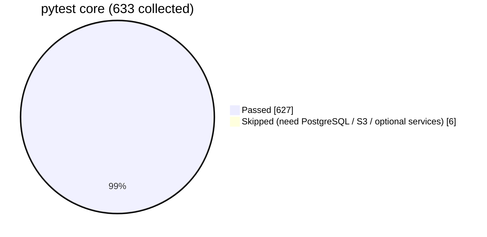
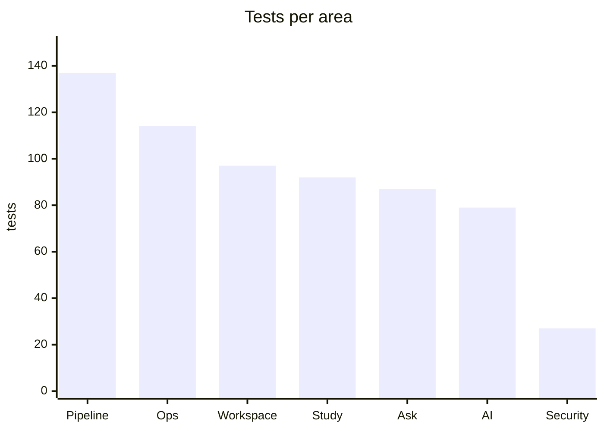
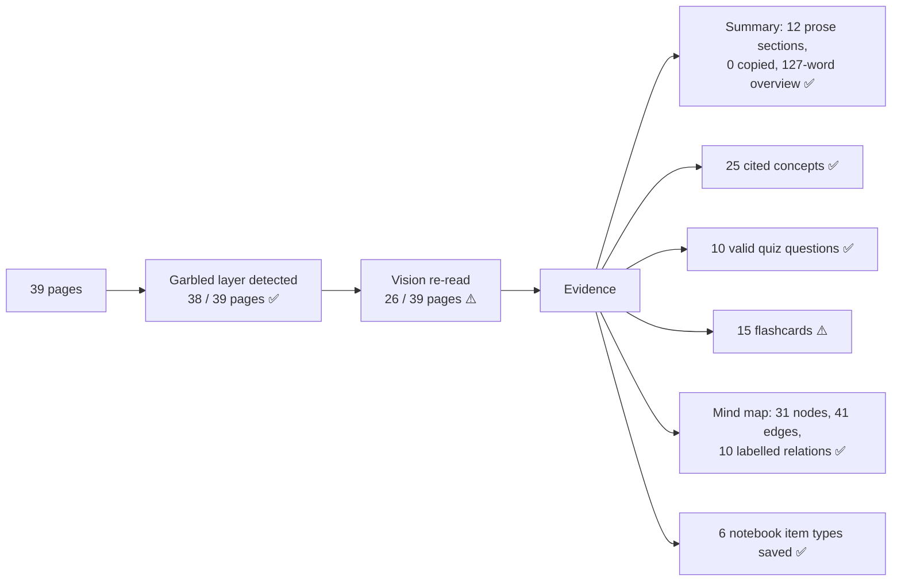
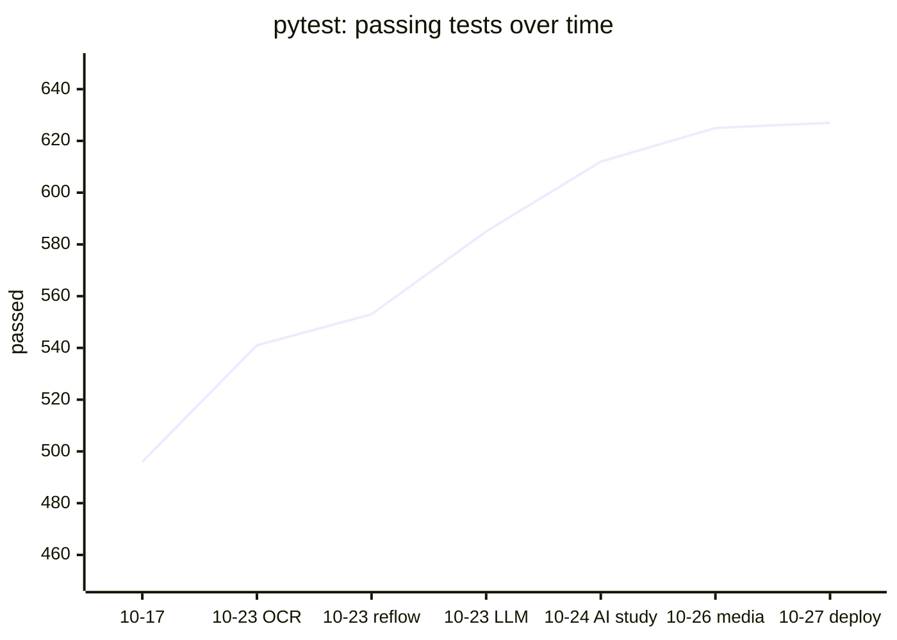

# Notiv — Results and testing

What has been run, what it showed, and what has **not** been verified. Method and thresholds are in
[Evaluation](EVALUATION.md). Latest state: **2026-10-27**, macOS, Python 3.12 venv.

## 1. Scoreboard

| Check | Result | Status |
|---|---|---|
| Unit + integration tests (`pytest core`) | **627 passed, 6 skipped, 0 failed** (633 collected) | ✅ |
| Browser end-to-end (`tools/e2e_redesign.py`, real Chromium) | **15 / 15**, zero console errors | ✅ |
| Format robustness matrix (`tools/eval_format_matrix.py`) | **33 / 33** correct outcomes (PDF 11, PPTX 7, MP3 7, MP4 8) | ✅ |
| AI scorecard, offline (`tools/eval_ai_study.py`) | retrieval **100 %**, answer correct **100 %**, citations **100 %**, abstention **100 %** | ✅ |
| Live handwritten PDF (`tools/e2e_system_design.py`, run 2) | **31 / 34** checks | ⚠️ vision quota ran out |
| Live MP3 transcription (49 s) | WER **0.0 %**, 20 segments, processed in 30 s | ✅ |
| Live MP4 transcription (45 s) | WER **0.8 %**, 17 segments, processed in 21 s | ✅ |
| Live AI study material from recordings | not run | ❌ no working provider |
| AI scorecard `--live` | not run | ❌ no working provider |
| PostgreSQL, S3, Docker image | not run in this environment | ❌ unverified |



## 2. Test suite by area

| Area | Files | Tests |
|---|---|---|
| Ingestion and pipeline | `test_lecture_pipeline`, `test_foundation`, `test_hardening`, `test_ocr`, `test_reflow`, `test_worker_lifecycle`, `test_integration_whisper` | 137 |
| Production operations | `test_sprint5_ops`, `test_sprint5_http`, `test_sprint5_core`, `test_sprint5_fastapi`, `test_pg_translate`, `test_pg_adapter_logic`, `test_pg_contract`, `test_s3_integration` | 114 |
| Workspace, notes, notebooks | `test_workspace`, `test_workspace_api`, `test_notes`, `test_notebooks`, `test_library_api` | 97 |
| Study and knowledge | `test_study`, `test_study_api`, `test_question_bank` | 92 |
| Ask and retrieval | `test_ask`, `test_ask_api`, `test_retrieval_modes` | 87 |
| AI layer | `test_llm`, `test_ai_study`, `test_media_study`, `test_ai_quiz`, `test_eval_regressions` | 79 |
| Security and auth | `test_api_boundary`, `test_ui_security`, `test_auth_cookie_integration`, `test_password_auth` | 27 |
| **Total** | 35 files | **633** |



Notes:

* In tests, model calls are **faked** (`NOTIV_AI_STUDY=off`, `NOTIV_VISION=off`, `NOTIV_OCR=off` in `conftest`, except in
  the tests that switch them on). They prove grounding, validation and plumbing, not AI quality.
* Four legacy modules (`test_extractor_findings`, `test_job_queue`, `test_rag_engine`, `test_vector_store`) belong to the
  old meeting/RAG prototype and are not collected (they need LangChain/Streamlit). They are not part of Notiv.

## 3. Format matrix detail (2026-10-27)

| Format | Valid → processed | Invalid → rejected clearly | Score |
|---|---|---|---|
| PDF | 7 / 7 (incl. scanned OCR, rotated, mixed sizes, Unicode, 60 pages) | 4 / 4 (encrypted, damaged, PNG renamed, empty) | 11 / 11 |
| PPTX | 6 / 6 (incl. hidden slide order, grouped shapes, image-only OCR, 30 slides) | 1 / 1 | 7 / 7 |
| MP3 | 5 / 5 (incl. 8 kHz, cover art, background noise) | 2 / 2 (silence → "no speech", WAV renamed) | 7 / 7 |
| MP4 | 6 / 6 (incl. HEVC, 9:16 60 fps, picture longer than sound) | 2 / 2 (no audio, MKV renamed) | 8 / 8 |

Not covered by the matrix: handwriting (needs a vision provider) and real-world, non-TTS recordings.

## 4. Live handwritten PDF (`systemdesgin.pdf`, 39 pages) — run 2



* **Passed (31):** garbled layer reported; prose summary; concepts keep source definition separate from the labelled
  supplementary explanation; quiz valid; mind map; notebook items and canvas; another user gets 404.
* **Failed (3):** only 26 of 39 pages were re-read, so indexes, queues, long polling and websockets were missing and
  only 15 flashcards were made. Cause: Groq's free-tier **daily** token limit for the vision model ran out during testing.
* **Fixed after run 2, unit-tested, not re-run live:** daily limits are reported as such and not waited for; Tesseract
  is no longer applied to handwriting-app pages (it had produced junk evidence on 8 pages); the definition prompt was
  tightened.

## 5. Live recordings (`tools/e2e_media.py`)

| File | Length | Processing | Segments | WER | Timestamps |
|---|---|---|---|---|---|
| MP3 | 49.0 s | 30 s | 20 | 0.0 % | ordered, inside the recording |
| MP4 | 45.2 s (picture longer than sound) | 21 s | 17 | 0.8 % | ordered, inside the recording |

The first MP4 run failed with "audio extraction is truncated: decoded 39.4 s of 45.0 s": audio was compared against
the container length instead of the audio track. This was fixed (`probe()` returns `audio_duration`) and covered by a
regression test before the re-run.

Unverified: long recordings (only ~45–50 s files were tested live), real human speech (TTS was used) and a live
video + slides run.

## 6. Browser end-to-end

`tools/e2e_redesign.py` runs a real backend and real Chromium (Playwright). It covers:

* landing with the exact hero image, nav and no overflow;
* registration through the UI, landing in the app;
* the desk;
* uploading PDF + MP3 and PPTX + MP4, with processing shown through to a final state;
* the library listing lectures with their states;
* the study view (viewer, transcript, navigation);
* the full-size Ask chat with real answers and citations;
* the companion and focus timer persisting across reload;
* the question bank;
* the account page and sign out;
* mobile layout for landing, auth and desk.

Result: **15 / 15** before and after the last UI pass, console errors `[]`.

An earlier browser suite (`tools/e2e_ui.py`, 47 / 47 on 2026-10-17) covered the previous markup and the since-removed
OIDC flow; it is kept for reference.

## 7. Regression history



| Date | Change | pytest | Other runs |
|---|---|---|---|
| 2026-10-17 | baseline after hardening and redesign | 496 passed, 5 skipped | browser e2e 47 / 47 |
| 2026-10-23 | dependencies, readiness, page-text warnings, OCR fallback | 541 passed, 6 skipped | real Whisper integration 1 passed |
| 2026-10-23 | reflow of wrapped PDF / OCR text | 553 passed | document PDF → 19 study items, 10 flashcards |
| 2026-10-23 | one answer-model layer (OpenAI → Mistral → Anthropic) | 585 passed | live provider calls: not run (no keys) |
| 2026-10-24 | PDF/PPTX AI study material | 612 passed | live handwritten PDF 31 / 34 |
| 2026-10-26 | MP3 / MP4 study workflow | 625 passed | MP3 WER 0.0 %, MP4 WER 0.8 % |
| 2026-10-27 | deploy audit, evaluation tools, UI polish | 627 passed, 6 skipped | e2e 15 / 15, matrix 33 / 33, offline AI 100 % |

## 8. Bugs found by evaluation runs (all have regression tests)

| Found by | Bug | Fix |
|---|---|---|
| live handwritten PDF | OpenAI `insufficient_quota` shown as "busy" | classified as `quota_exhausted`, named in the UI |
| live handwritten PDF | `OPENAI_MODEL` pointed OpenAI calls at a Groq model | `NOTIV_OPENAI_MODEL` takes precedence; `diagnose()` reports it |
| live handwritten PDF | batch backoff gave up when providers failed for mixed reasons | waits if any failure is transient |
| live handwritten PDF | Tesseract junk from handwriting accepted as evidence | garbled-layer pages never OCR'd |
| live MP4 | false "truncated audio" when picture is longer than sound | compare against the audio track's duration |
| offline AI scorecard | Ask quote mode answered with a slide heading (87.5 % → 100 %) | headings skipped as answers |
| browser e2e | landing hero hidden at opacity 0 by the entrance animation | transform-only animation |

## 9. Not verified — read before deploying

| Item | Why | How to verify |
|---|---|---|
| Live AI output (Ask with model, study material, AI quiz, vision) | OpenAI has no credits; the Groq key is rejected (401) | add a working key, run `tools/llm_smoke.py`, then `tools/eval_ai_study.py --live`, `tools/e2e_media.py both`, `tools/e2e_system_design.py <pdf>` |
| Full 39-page handwritten coverage | vision daily limit | as above |
| PostgreSQL and S3 | services not available here | `bash tools/verify_sprint5.sh` with `docker-compose.sprint5.yml` |
| Docker image | not built here | `docker build -t notiv .` and run the stack |
| SMTP password reset delivery | no relay configured | configure `NOTIV_SMTP_*`, request a reset |
| Long and real-speech recordings | only ~45 s TTS tested | upload a real lecture recording |

## 10. How to reproduce

```bash
export PYTHONPATH=.:core:backend
.venv/bin/python -m pytest -q core
.venv/bin/python tools/eval_format_matrix.py
.venv/bin/python tools/eval_ai_study.py
.venv/bin/python tools/e2e_redesign.py --out e2e-output
```
