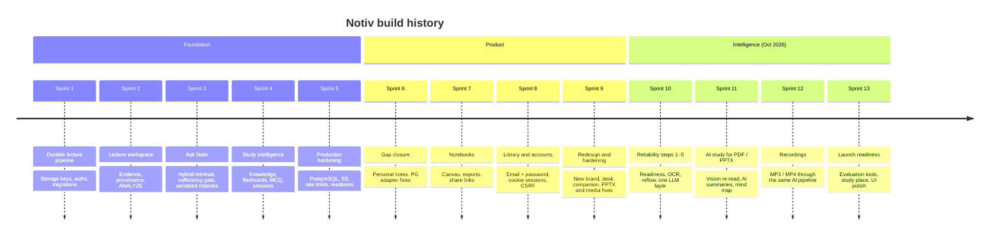

# Notiv — Sprints

How Notiv was built, sprint by sprint. Each sprint built on the previous one without rewriting it: the evidence model,
authorization, storage and durable jobs from Sprint 1 are still the base. Per-release changes are in the
[changelog](../CHANGELOG.md).

---

## Sprint 1 — Foundation

**Goal:** turn a monolithic `run_pipeline()` over absolute file paths into a durable, multi-user base.

* Storage **keys** instead of absolute paths; local and S3 storage behind one interface.
* Durable jobs with stages, retries and exponential backoff, replacing an in-process queue that was lost on restart.
* Workspace / course / lecture authorization; "missing" and "not yours" return the same 404.
* Checksummed migrations; the evidence model (`lecture_evidence`) that every later feature cites.
* The legacy meeting/RAG prototype was quarantined, not reused (no workspace scoping, Streamlit-bound).

## Sprint 2 — Lecture workspace and evidence

**Goal:** a lecture page where time, slide and transcript stay in sync and every generated line shows its source.

* Position sync (time ↔ slide ↔ transcript), provenance labels (Professor said / Slide text / Notiv analysis).
* Key moments and summary sections built only from stored evidence; `ANALYZE` stage added after `INDEX`.
* Workspace API (overview, timeline, transcript, slides, evidence, search, key moments, summary, position).
* Framework-neutral handlers plus a stdlib dev server so the HTTP layer is testable without FastAPI.

## Sprint 3 — Ask Notiv

**Goal:** answers grounded in one lecture, or an honest "not enough evidence".

* Hybrid retrieval: BM25 (FTS5) + vectors, reciprocal-rank fusion, neighbour context, follow-up condensation, scope
  ("slide 4", "at 12:30").
* Sufficiency gate decided from the evidence: the question's content terms must be covered, otherwise the model is never
  called.
* Prompt-injection screen: instruction-like lecture text is withheld from the model and from quotes.
* Citation validation: ids must be evidence shown to the model, and every sentence is cited and lexically supported.
* Per-user conversations per lecture.

## Sprint 4 — Study intelligence (extractive)

**Goal:** flashcards and quizzes that use only the lecture's own words.

* Knowledge kinds: concept, definition, formula, fact, example, emphasis, warning.
* Study items: flashcard, short answer, MCQ (distractors are the lecture's other terms), cloze, with difficulty.
* `study_store._check_links`: each quote must literally occur in evidence from this lecture.
* Study sessions, attempts and progress; edited items are marked "not machine-verified" and survive regeneration.

## Sprint 5 — Production hardening

**Goal:** safe to run with several replicas.

* PostgreSQL adapter and migrations, private S3 with **positive proof** of privacy, idempotency keys.
* Shared (database) or explicitly single-instance rate limiting; limiter outage reported as `DEGRADED`.
* `/readyz`, `/metrics` with token, audit log, deletion outbox, worker heartbeats, fenced job finalization.
* A production config gate that refuses weak secrets, SQLite, local storage and `*` CORS.
* Fixed: oversized ids → 500 (now 404); bad POST bodies → 500 (now 422).

## Sprint 6 — Gap closure

* Personal notes linked to evidence (migration 0003), included in lecture deletion and user erasure.
* PostgreSQL adapter: a failed statement left the cached connection's transaction aborted, so every later query failed.
  Fixed with rollback.
* Retrieval honesty: responses state `bm25_only`, `lexical_subword` or `semantic`.
* Live lecture capture explicitly **deferred** (uploads only).

## Sprint 7 — Notebooks

* Notebooks with sources, notes, generated items and a canvas with connections (migration 0004).
* Exports: JSON, Markdown, TXT, CSV, SVG, PDF, DOCX, PPTX.
* Read-only share links (SHA-256 token hashes, expiry, revocation, no-index page).
* Lecture picker, drawn canvas connections, idempotent source linking.

## Sprint 8 — Library and accounts

* Lecture library at `/app` with courses, upload, progress polling, retry and confirmed delete.
* Email + password accounts (scrypt), opaque HttpOnly cookie sessions, CSRF, one-time 30-minute reset tokens via SMTP
  (migration 0006).
* Bearer tokens in `sessionStorage` removed from the browser; auth UI rebuilt with DOM APIs (no `innerHTML`).

## Sprint 9 — Redesign and hardening

* New brand (logo, ember + dusk palette from the hero photo, self-hosted Fraunces / Instrument Sans).
* Desk with a next-action card, compact rail, study companion cat with Pomodoro timer, question bank (migration 0007),
  AI quiz UI, account page.
* PPTX: hidden slides were dropped by LibreOffice, shifting text onto the wrong pictures. Hidden slides are now exported
  and the count is checked.
* Pages rendered at a 1600 px long edge with zoom; subprocess groups killed on timeout; truncated audio detected.
* Ask: definition questions are answered only from a defining passage; "never defined" is said with citations.
* Uploads limited to PDF, PPTX, MP3, MP4. **Google / OIDC sign-in removed.**

## Sprint 10 — Reliability, steps 1–5 (2026-10-23)

| Step | Change |
|---|---|
| 1 | Dependencies and environment; `/readyz` reports missing processing tools and Python packages |
| 2 | Pages without text surfaced as warnings instead of silently empty |
| 3 | Tesseract OCR fallback for scanned PDFs, low-confidence text discarded |
| 4 | `reflow`: re-join hard-wrapped PDF/OCR lines so definitions, flashcards and Ask quotes are whole sentences |
| 5 | One answer-model layer: OpenAI first, then Mistral and Anthropic fallbacks (Groq added later; Lovable opt-in) |

pytest went from 496 to 585.

## Sprint 11 — AI study intelligence for PDF / PPTX (2026-10-24)

Regression target: a 39-page handwritten system-design PDF with a garbled text layer.

* `text_quality` detects garbled layers; vision model re-reads those pages; unreadable pages excluded and reported.
* `ai_study.py`: chunked map calls plus a synthesis call for overview, takeaways, topics, sections, concepts, relations,
  examples, comparisons, flashcards and quiz, all validated before saving (migration 0008).
* Mind map built from AI concepts and labelled relations; notebooks receive AI items.
* Provider failures named (no credits, daily limit, bad key, unsupported model); `OPENAI_MODEL` mix-up diagnosed.
* Live run: 31 / 34 (vision daily quota ran out).

## Sprint 12 — Recordings (2026-10-26)

* MP3 / MP4 go through the same AI study pipeline: transcript lines are evidence, and items carry `times` the way
  documents carry `pages`.
* Summary sections carry `start` / `end`; takeaways seek the player.
* Fixed a false "truncated audio" failure when an MP4's picture is longer than its sound.
* Live WER: MP3 0.0 %, MP4 0.8 %.

## Sprint 13 — Launch readiness (2026-10-27)

* Evaluation tools: format matrix (33 variants), AI scorecard with thresholds, live media and handwritten-PDF checks.
* Ask no longer quotes a slide heading as the answer (answer correctness 87.5 % → 100 %).
* Landing rebuilt around the hero photograph (night hero, answer card with receipts, editorial features).
* Auth rebuilt: full-bleed photo, solid card, segmented switch, grouped fields, strength meter, Caps Lock hint.
* Study place: Today panel (goal ring, streak, week bars, focus start, continue last lecture), ambient sound, fixed
  the "done today" counter that never reset.
* iOS-style layer: 44 px targets, press feedback, segmented controls, pill tabs, switches, bottom sheets; no
  glassmorphism or backdrop blur.
* Production gate allows single-instance SQLite / local storage only with explicit overrides.

## What is next

* Run the live checks with a working provider key (see [Results and testing §9](RESULTS_AND_TESTING.md#9-not-verified--read-before-deploying)).
* Verify PostgreSQL, S3 and the Docker image with `tools/verify_sprint5.sh`.
* Test long, real-speech recordings.
