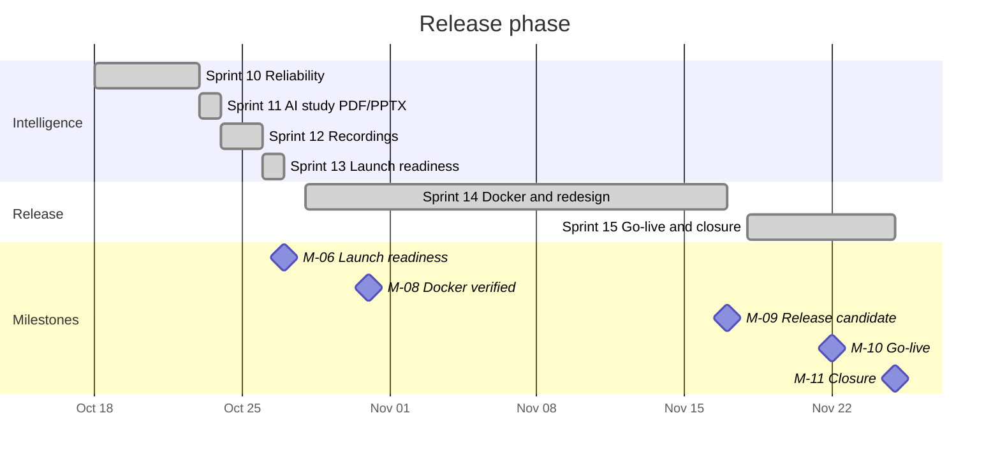

# Notiv — Milestones

Each milestone has exit criteria and the evidence that it was met. Dates come from git history, the
[changelog](../CHANGELOG.md) and the [test log](../RESULTS_AND_TESTING.md#7-regression-history). Dates inside
Sprints 1–9 were not recorded.

| ID | Milestone | Date | Exit criteria | Evidence | Status |
|---|---|---|---|---|---|
| M-00 | First prototype | 2026-06-27 | An end-to-end MVP runs | commits `4388bbf`, `0be2c67` (meeting-intelligence MVP) | ✅ |
| M-01 | Foundation complete (Sprints 1–5) | before 2026-10-17 | Durable jobs survive restarts; every output cites stored evidence; Ask answers or abstains; production config gate | [Sprints 1–5](../SPRINTS.md#sprint-1--foundation) | ✅ |
| M-02 | Usable product (Sprints 6–9) | 2026-10-17 | Library, accounts, notebooks, redesign; tests pass | pytest 496 passed; browser e2e 47 / 47 (then-current script) | ✅ |
| M-03 | Reliable reading of real files | 2026-10-23 | Scanned pages OCR'd; empty pages reported; wrapped lines re-joined; one AI provider layer | pytest 585 passed | ✅ |
| M-04 | AI study material for PDF / PPTX | 2026-10-24 | Every AI item validated before saving; handwritten pages re-read | pytest 612 passed; handwritten PDF 31 / 34 (AI vision quota ran out) | ⚠️ met with a known gap |
| M-05 | Recordings | 2026-10-26 | MP3 / MP4 through the same AI pipeline with timestamps | pytest 625 passed; WER 0.0 % / 0.8 % | ✅ |
| M-06 | Launch readiness | 2026-10-27 | Evaluation tools with thresholds that can block a deploy | format matrix 33 / 33; offline AI scorecard 100 % | ✅ |
| M-07 | Production-grade code on `main` | 2026-10-28 | Replaces the prototype; reviewed through a pull request | PR #1 merged (`bc79c5b`) | ✅ |
| M-08 | Docker image verified | 2026-10-31 | Image builds and passes the deployment smoke test behind an HTTPS proxy | smoke 41 / 41; three deploy blockers fixed (`9262645`) | ✅ |
| M-09 | Release candidate | 2026-11-17 | Redesign, PDF-only export, course delete, pre-release audit; PostgreSQL + S3 verified | pytest 636 passed, 2 skipped; e2e 18 / 18; smoke 41 / 41 on both setups; PR #2 merged (`112ee00`) | ✅ |
| M-10 | Go-live | 2026-11-22 | Public demo deployed from the repository and verified end to end | live checks **76 / 76** ([Results §6c](../RESULTS_AND_TESTING.md#6c-live-deployment-railway)); `3288aeb` | ✅ |
| M-11 | Project closure | 2026-11-25 | Documentation complete; open items handed to the backlog | this folder; [closure report](PROJECT_CLOSURE_REPORT.md) | ✅ |

Bar start dates are approximate: each bar starts after the previous recorded date. End dates are the recorded ones.
