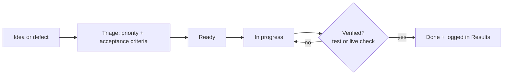

# Notiv — Product backlog

State at project close (2026-11-25). Priority uses MoSCoW: **Must**, **Should**, **Could**, **Won't (now)**. Delivered
work is grouped into epics; open items carry acceptance criteria so they can be picked up directly.

## 1. Delivered epics

| Epic | Scope | Sprints | Requirements | Status |
|---|---|---|---|---|
| E1 Durable processing | Upload validation, staged pipeline, retries, restart-safe jobs | 1, 5, 10 | FR-1, FR-2, FR-8 | ✅ Done |
| E2 Reading real files | OCR, vision re-read, PPTX hidden slides, line re-joining | 9, 10, 11 | FR-3, FR-4, FR-5 | ✅ Done (handwriting: 31 / 34, see B-04) |
| E3 Recordings | Transcription with timestamps, speech-to-slide matching | 2, 12 | FR-6, FR-7 | ✅ Done |
| E4 Grounded Ask | Retrieval, sufficiency gate, citation validation, injection screen | 3, 9 | FR-11 → FR-14 | ✅ Done |
| E5 Study material | Extractive then AI summaries, concepts, flashcards, quiz, mind map | 4, 11, 12 | FR-9, FR-10 | ✅ Done |
| E6 Workspace | Library, courses, delete, notes, notebooks, canvas, share links, PDF export | 6, 7, 8, 14 | FR-15, FR-16 | ✅ Done |
| E7 Accounts and security | Email + password, cookie sessions, CSRF, per-user privacy, production gate | 5, 8 | FR-17 → FR-19 | ✅ Done (email delivery: see B-05) |
| E8 Release | Docker image, evaluation tools, redesign, audit, live deployment | 13, 14, 15 | NFR-1 → NFR-7 | ✅ Done |

Requirement IDs: [PRD](PRD.md).

## 2. Open items

| ID | Item | Priority | Why | Acceptance criteria |
|---|---|---|---|---|
| B-01 | Re-run the live AI scorecard | Must | The AI scorecard has only been run offline since the API key changed | `tools/eval_ai_study.py --live` meets every threshold in [Evaluation §4](../EVALUATION.md#4-ai-scorecard-golden-set); result logged in Results |
| B-02 | Measure transcription accuracy of the live `base` model | Must | WER (0.0 % / 0.8 %) was measured with the `small` model; the live demo uses `base` | `tools/e2e_media.py both` with `NOTIV_WHISPER_MODEL=base`; WER logged |
| B-03 | Test real, long lecture recordings | Must | Only ~45-second synthetic speech was tested live | A real recording of 45+ minutes processes; WER measured on a 5-minute hand-checked sample |
| B-04 | Full re-run of the 39-page handwritten PDF | Should | The last run stopped at 31 / 34 when the AI vision quota ran out | 34 / 34 with a sufficient quota, or the remaining gap named |
| B-05 | Email for password reset | Should | Reset is built and unit-tested, but no email service is configured on the live demo | A reset email arrives and the link works once, within 30 minutes |
| B-06 | Automatic backups of the data volume | Should | There are no automatic backups of the live volume | Daily snapshot; a restore tested once |
| B-07 | Run tests on every pull request (CI) | Should | Tests run locally only | A GitHub Actions workflow runs `pytest core` on each PR and blocks merging on failure |
| B-08 | Usability test with students | Should | No formal user research was run | 5 students complete 4 core tasks (upload, study, ask, export); success rate and issues recorded |
| B-09 | Hindi / Hinglish lectures | Should | Many Indian lectures mix languages | WER measured on 3 mixed-language recordings; decision recorded |
| B-10 | Multi-server deployment and load test | Could | The live demo is single-instance | PostgreSQL + S3 setup on a host; behaviour under concurrent users measured |
| B-11 | Privacy-respecting usage analytics | Could | Feature usage is unknown | Counts per feature without personal data; reviewed after 30 days |
| B-12 | Human-rated answer quality | Could | The support check is a word-overlap proxy, not a human judgement | 50 answers rated by a person; agreement with the automatic check reported |
| B-13 | Monitoring and alerts | Could | `/metrics` is not enabled on the live demo | Metrics on with a token; an alert when `/readyz` fails |
| B-14 | Live lecture recording | Won't (now) | Needs streaming infrastructure; uploads cover the current need | Revisit after B-08 shows demand |
| B-15 | YouTube / web import | Won't (now) | Unreliable to fetch and raises content-rights questions | — |
| B-16 | Social sign-in | Won't (now) | Removed in Sprint 9: more setup and attack surface for little value | — |

## 3. How items move

An item is **done** only when the check in its acceptance criteria has been run and its result recorded in
[Results and testing](../RESULTS_AND_TESTING.md). New items use the GitHub issue templates in `.github/ISSUE_TEMPLATE/`.
