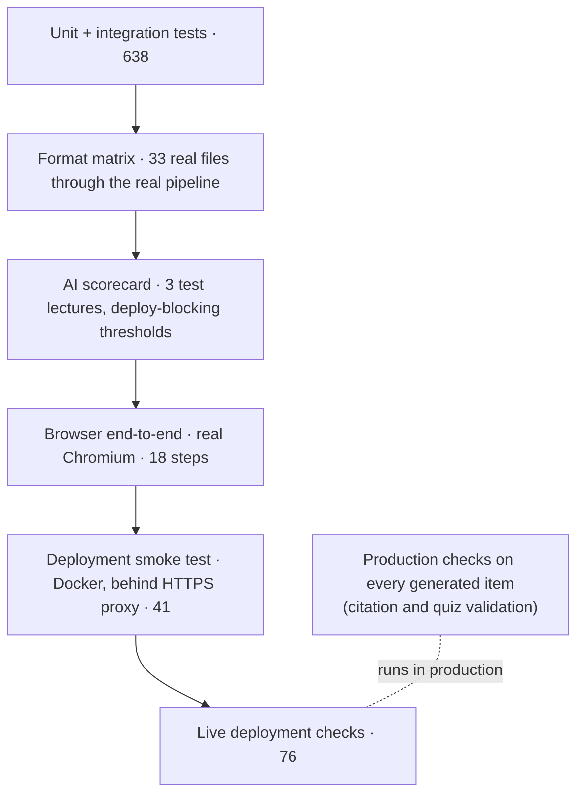

# Notiv — QA test report

| | |
|---|---|
| Release | Notiv 1.0, live demo (deployed 2026-11-22) |
| Report date | 2026-11-25 |
| Tester | Shreya Joshi |
| Recommendation | **Go for public demo use.** Not yet for real student use at scale until the [Must items](#7-release-recommendation) are closed |
| Detailed log | [Results and testing](../RESULTS_AND_TESTING.md) (source of truth for every number) · method: [Evaluation](../EVALUATION.md) |

## 1. Scope

| In scope | Out of scope |
|---|---|
| Upload validation and processing of PDF, PPTX, MP3, MP4 | Load and performance testing under many users |
| AI study material and Ask (grounding, citations, abstention) | Formal accessibility audit |
| Library, notebooks, PDF export, course and lecture delete | Real student usability testing |
| Accounts, sessions, CSRF, per-user privacy | Email delivery (no email service configured) |
| Docker image, PostgreSQL + S3 setup, live deployment | Browsers other than Chromium |

## 2. Approach

* **Entry criteria for a release:** all automated tests pass; no open defect that breaks a must-have requirement.
* **Exit criteria:** format matrix all correct; scorecard at or above every threshold; browser e2e and deployment smoke
  test all pass; live checks all pass.
* **Rule:** every defect found gets a regression test before the run is repeated.

## 3. Environments

| Environment | Setup |
|---|---|
| Local | macOS, Python 3.12, SQLite and local files |
| Local, multi-server shape | PostgreSQL 16 + S3 (SeaweedFS) via `docker-compose.sprint5.yml` |
| Docker | the production image, single instance, behind a simulated HTTPS proxy |
| Live | Railway, `https://notiv-production.up.railway.app`, Groq answer model, `base` speech model |

## 4. Results

| Test level | Result | Date | Exit criterion met |
|---|---|---|---|
| Unit + integration tests (PostgreSQL + S3 enabled) | **636 passed, 2 skipped**, 0 failed (638) | 2026-11-17 | ✅ |
| Format matrix | **33 / 33** (PDF 11, PPTX 7, MP3 7, MP4 8) | 2026-10-27 | ✅ |
| AI scorecard, offline | **100 %** retrieval, answer correct, citation validity, abstention | 2026-10-31 | ✅ |
| Transcription (live provider, synthetic speech) | WER **0.0 %** MP3, **0.8 %** MP4 | 2026-10-26 | ✅ |
| Hard real document (39 handwritten pages) | **31 / 34** | 2026-10-24 | ⚠️ AI vision quota ran out |
| Browser end-to-end | **18 / 18**, zero console errors | 2026-11-17 | ✅ |
| Deployment smoke test | **41 / 41** in Docker (SQLite) and on PostgreSQL 16 + S3 | 2026-11-17 | ✅ |
| Live deployment | **76 / 76** (29 + 25 + 22) | 2026-11-22 | ✅ |

The 2 skipped tests need real-speech fixtures or a Whisper-free environment
([Results §1](../RESULTS_AND_TESTING.md#1-scoreboard)).

## 5. Defects found and fixed

All have regression tests, except the five live configuration issues, which were settings rather than code.

| # | Found by | Defect | Severity | Fix |
|---|---|---|---|---|
| 1 | Live handwritten PDF | Provider quota error shown to the user as "busy" | Medium | Classified as quota exhausted and named in the UI |
| 2 | Live handwritten PDF | A model setting pointed OpenAI calls at a Groq model | High | Provider-specific setting takes precedence; diagnosed by `diagnose()` |
| 3 | Live handwritten PDF | Batch retries gave up when providers failed for mixed reasons | Medium | Waits if any failure is temporary |
| 4 | Live handwritten PDF | OCR junk from handwriting accepted as evidence | High | Garbled-layer pages are never OCR'd |
| 5 | Live MP4 | False "truncated audio" when the picture is longer than the sound | High | Compared against the audio track's own length |
| 6 | AI scorecard | Ask quoted a slide heading as the answer (87.5 % → 100 %) | Medium | Headings skipped as answers |
| 7 | Browser e2e | Landing hero invisible because of the entrance animation | Medium | Animation changed |
| 8 | Docker smoke | App could not write to a root-owned volume | Critical | Entrypoint fixes ownership, then drops to a non-root user |
| 9 | Docker smoke | Behind an HTTPS proxy every write failed the origin check | Critical | Proxy headers trusted |
| 10 | Docker smoke | Ask abstained on "write-through" vs "write through" | Medium | Hyphenated and joined forms matched |
| 11 | Full suite | A test depended on a secret set in the shell | Low | Test sets its own secret |
| 12 | Pre-release audit | Deployment env files copied into the Docker image | Critical | Excluded in `.dockerignore` |
| 13 | Pre-release audit | Docker image could not export PDF (library missing) | High | Added to production requirements |
| 14 | Pre-release audit | Course page listed only processed lectures | Low | Lists all lectures |
| 15–19 | Going live | Dockerfile `VOLUME` rejected; variables not deployed; port mismatch (502); URL typos; disk full from the model cache | Critical (site down) | See [Results §6c](../RESULTS_AND_TESTING.md#6c-live-deployment-railway) |

**Open defects at release:** none known.

## 6. Not verified

| Item | Why | Backlog |
|---|---|---|
| Live AI scorecard | not re-run since the API key changed | B-01 |
| Transcription accuracy of the live `base` model | WER was measured with `small` | B-02 |
| Long, real-speech recordings | only ~45-second synthetic speech tested | B-03 |
| Full handwritten document coverage | AI vision quota ran out at 31 / 34 | B-04 |
| Password-reset email delivery | no email service configured | B-05 |
| Many simultaneous users | single instance, no load test | B-10 |

## 7. Release recommendation

**Go** for the public demo: every exit criterion is met except the handwritten-document run, whose gap is caused by
an external quota and is labelled in the product. Before real students rely on it, close **B-01, B-02 and B-03** (all
Must) and configure email (**B-05**).
