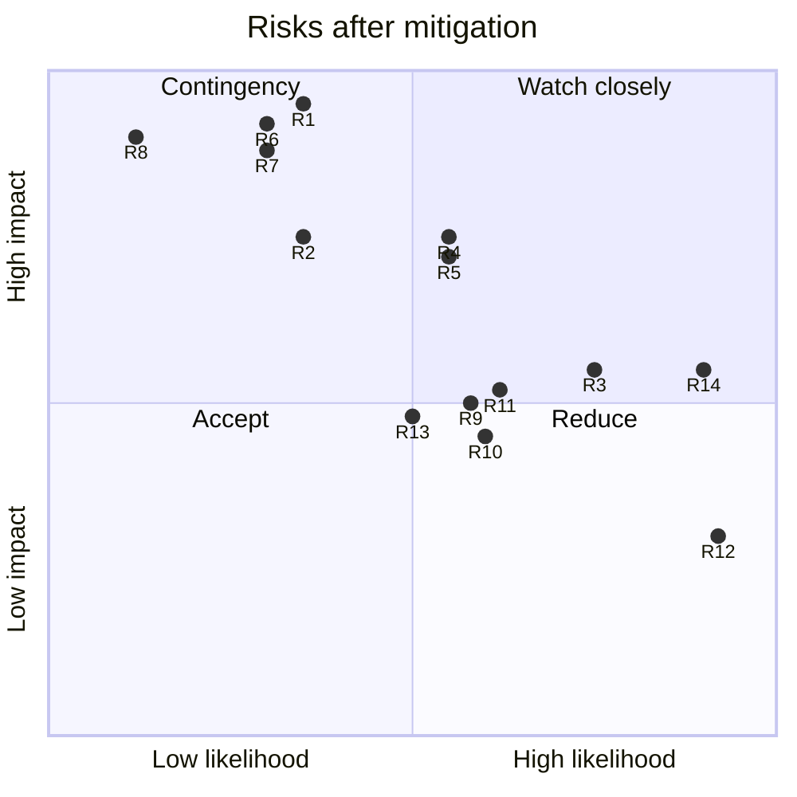

# Notiv — Risk register

State at project close (2026-11-25). **Likelihood** and **impact** are scored 1 (low) to 5 (high); **score** =
likelihood × impact. ≥ 12 is high, 6–11 medium, ≤ 5 low. Scores are *after* mitigation. "Occurred" marks risks that
actually happened during the project.

| ID | Risk | L | I | Score | Mitigation | Occurred | Status |
|---|---|---|---|---|---|---|---|
| R1 | AI makes up content that is not in the lecture | 2 | 5 | 10 | Output built only from evidence; every sentence must cite evidence it was shown; unsupported sentences removed; falls back to quotes; scorecard blocks deploys below threshold | — | Mitigated, monitored (support check is a word-overlap proxy: B-12) |
| R2 | Prompt injection through text inside an uploaded lecture | 2 | 4 | 8 | Instruction-like text screened out; evidence fenced in the prompt; output validated | — | Mitigated |
| R3 | AI provider fails or runs out of quota | 4 | 3 | 12 | Fallback chain across 4 providers; cool-downs; named reasons in the UI; extractive material without any provider | **Yes**: vision daily quota (2026-10-24), OpenAI quota error shown as "busy" (fixed) | Mitigated, high likelihood remains on free tiers |
| R4 | Real files are messy (scanned, handwritten, broken, renamed) | 3 | 4 | 12 | Contents checked, not names; OCR and vision re-read; unreadable pages excluded and named; 33-file format matrix | **Yes**: hidden PPTX slides shifted text; Tesseract junk on handwriting (both fixed) | Mitigated |
| R5 | Hosting runs out of disk or memory | 3 | 4 | 12 | 2 GB RAM minimum; smaller live speech model; troubleshooting documented | **Yes**: volume full from the model cache (2026-11-22) | Mitigated, monitor volume size |
| R6 | Data lost on redeploy | 2 | 5 | 10 | Persistent volume at `/data`; restart test passed (accounts, lectures and model survive) | — | Mitigated for redeploys; no automatic backups yet (B-06) |
| R7 | Secrets leak (keys in the image or repository) | 2 | 5 | 10 | Secrets only as platform variables; `.env` files git-ignored and excluded from the Docker image; production mode refuses weak secrets | **Yes**: env files were being copied into the image (found in the 2026-11-17 audit, fixed) | Mitigated |
| R8 | One user sees another user's data | 1 | 5 | 5 | Every lecture, notebook and summary scoped to its owner; "not yours" returns 404; checked in tests, Docker and live | — | Mitigated |
| R9 | Hosting credit runs out and the demo goes offline | 3 | 3 | 9 | Single-instance setup keeps cost low; the image runs on any Docker host | — | Open: add a payment method or move host before credit ends |
| R10 | Single instance cannot handle many users | 3 | 3 | 9 | Multi-server setup (PostgreSQL + S3) built and verified locally | — | Accepted for a demo (B-10) |
| R11 | Claims not proven on real-world use | 3 | 3 | 9 | Every number reported only after its run; gaps labelled "not verified" | — | Open (B-01 → B-03, B-08) |
| R12 | Password reset unavailable on the live demo | 5 | 2 | 10 | Clear message instead of a silent failure | **Yes** (no email service configured) | Accepted for a demo (B-05) |
| R13 | Scope creep for a one-person project | 3 | 3 | 9 | Explicit non-goals; cuts recorded in the decision log (8 export formats → 1, live capture deferred, social sign-in removed) | **Yes**: export formats built, then cut | Controlled |
| R14 | Key-person dependency (one developer) | 5 | 3 | 15 | Documentation, 638 automated tests, reproducible commands for every result | — | Accepted (inherent to a solo project) |

How to keep it current: update a row at each release and whenever a risk occurs; move "Occurred" risks into the
[QA test report](QA_TEST_REPORT.md#5-defects-found-and-fixed) or the [decision log](DECISION_LOG.md) with the fix.
