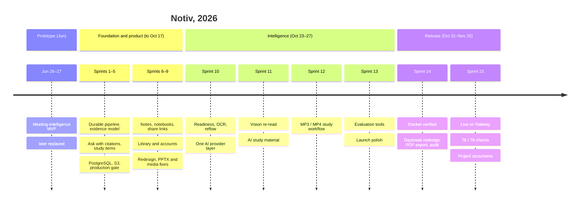
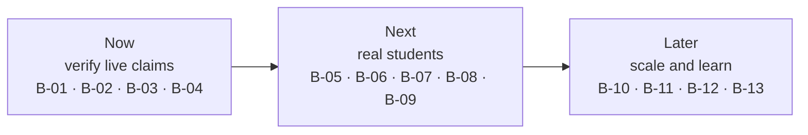

# Notiv — Roadmap

Where Notiv has been and where it goes next. Item IDs (B-xx) refer to the [product backlog](PRODUCT_BACKLOG.md);
milestone IDs (M-xx) to [milestones](MILESTONES.md).

## 1. Delivered

| Phase | Theme | Outcome | Milestones |
|---|---|---|---|
| Prototype | Prove the idea | A meeting-intelligence MVP; its code was later quarantined, then removed | M-00 |
| Foundation (Sprints 1–5) | Build a base that will not need rewriting | Durable jobs, evidence model, grounded Ask, study items, production hardening | M-01 |
| Product (Sprints 6–9) | Make it usable every day | Notes, notebooks, library, accounts, redesign | M-02 |
| Intelligence (Sprints 10–13) | Make it work on real, messy files | OCR, vision re-read, AI study material, recordings, evaluation tools | M-03 → M-06 |
| Release (Sprints 14–15) | Ship and prove it | Docker verified, release candidate, public demo, closure | M-07 → M-11 |

## 2. Now, next, later

Prioritised at project close (2026-11-25).

| Horizon | Goal | Items |
|---|---|---|
| **Now** (close the verification gaps) | Every claim measured on the live setup | B-01 live AI scorecard · B-02 transcription accuracy of the live `base` model · B-03 real, long recordings · B-04 full handwritten re-run |
| **Next** (make it safe to give to real students) | Reliability and feedback from real users | B-05 email for password reset · B-06 automatic backups · B-07 tests on every pull request (CI) · B-08 usability test with students · B-09 Hindi / Hinglish lectures |
| **Later** (grow) | Scale and learn from usage | B-10 multi-server deployment and load test · B-11 privacy-respecting usage analytics · B-12 human-rated answer quality · B-13 monitoring and alerts |
| **Not planned** | Deliberately out of scope | B-14 live lecture recording · B-15 YouTube / web import · B-16 social sign-in (reasons in the [decision log](DECISION_LOG.md)) |

The "Now" items come first because they are the gaps listed in [QA test report §6](QA_TEST_REPORT.md#6-not-verified):
nothing new should be claimed until the existing claims are measured on the live setup.
